# BÁO CÁO TIẾN ĐỘ (Tuần 1)

**Môn học:** Cấu trúc dữ liệu và Giải thuật.

**Mã lớp học phần:** DASA230179_Dot1, HK1 2026-2027.

**Giảng viên hướng dẫn:** Huỳnh Xuân Phụng.

**Thành viên nhóm:**

| Họ và tên | MSSV |
|---|---|
| Nguyễn Võ Quang Quý | 25110055 |
| Đào Nghiệm Minh | 25110042 |

**GitHub Repository:** https://github.com/QuangquyNguyenvo/DSA_final_project

## 1. Tổng quan

Sau khi rà soát quá trình thực hiện ban đầu, nhóm nhận thấy việc nghiên cứu và kiểm chứng các thuật toán chưa được thực hiện đủ kỹ lưỡng. Do đó, nhóm quyết định tổ chức lại quá trình triển khai, bắt đầu từ việc phân tích yêu cầu và nghiên cứu nguyên lý hoạt động của từng thuật toán. Trong tuần 1 của kế hoạch điều chỉnh, nhóm tập trung vào hai thuật toán sinh cấu hình theo thứ tự từ điển:

- Algorithm L (Lexicographic Permutation): sinh hoán vị kế tiếp theo thứ tự từ điển.
- Lexicographic Combination: sinh tổ hợp chập k của n theo thứ tự từ điển.

Mục tiêu là cài đặt hai thuật toán, kiểm tra tính đúng đắn trên các ví dụ cơ bản và làm nền tảng cho những giai đoạn tiếp theo.

## 2. Công việc thực hiện
### 2.1. Phân tích đề bài và lập kế hoạch
- Phân tích các yêu cầu chức năng và kỹ thuật của đề tài.
- Tham khảo tài liệu The Art of Computer Programming, Vol. 4A, Chapter 7.2.1 (Generating Combinatorial Patterns).
- Lập kế hoạch triển khai, phương pháp kiểm thử và danh sách sản phẩm cần hoàn thành.
- Chia kế hoạch thực hiện theo từng giai đoạn (3 tuần).
- Khởi tạo GitHub repository để quản lý mã nguồn và theo dõi lịch sử phát triển.

**Minh chứng:** 
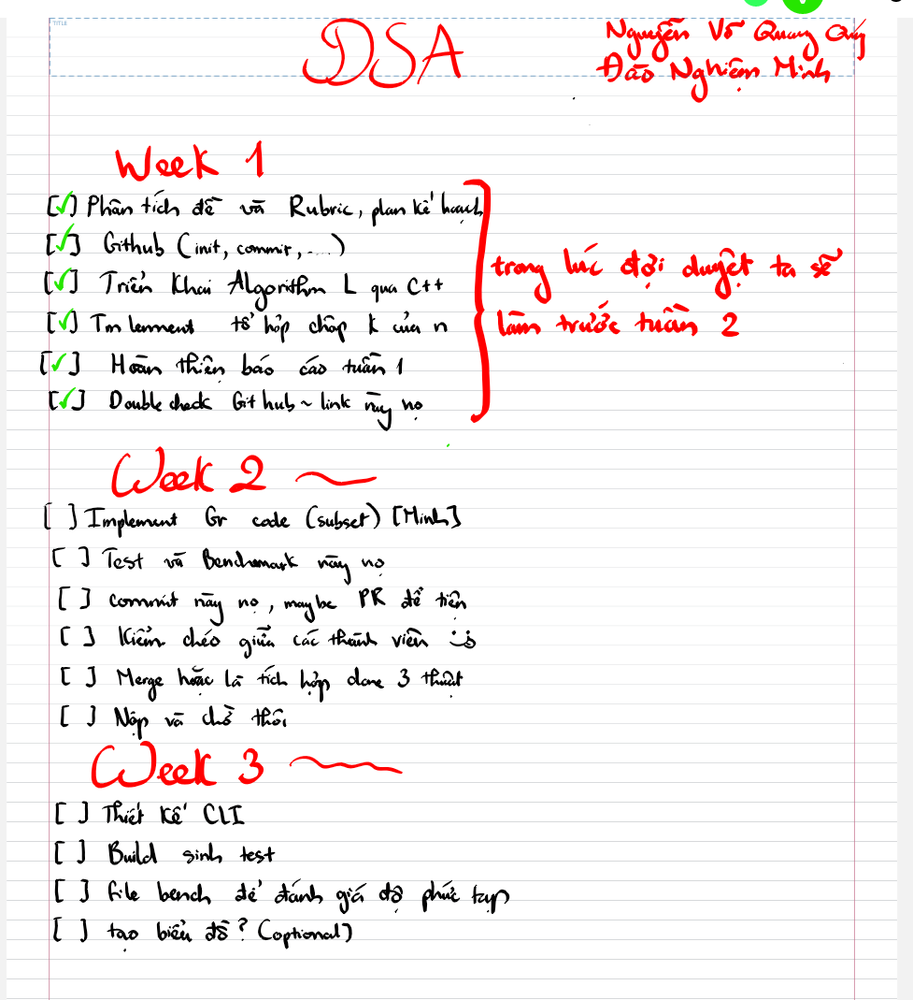
### 2.2. Algorithm L - Lexicographic Permutation
Nghiên cứu và triển khai thuật toán sinh hoán vị kế tiếp theo thứ tự từ điển.

Thuật toán hoạt động bằng cách tìm vị trí ngoài cùng bên phải còn có thể tăng (pivot), lựa chọn phần tử thay thế phù hợp, hoán đổi và đảo đoạn phía sau để tạo hoán vị kế tiếp nhỏ nhất (đúng với thứ tự từ điển).

Nội dung triển khai bao gồm:
- Xác định Pivot và các phần tử kế nhiệm (Successor).
- Hoán đổi và đảo đoạn suffix.
- Xử lý trường hợp không còn hoán vị kế tiếp (dãy đã giảm dần thì dừng).
- In lần lượt các hoán vị ra màn hình, bắt đầu từ cấu hình nhỏ nhất.

**Bảng hand trace:** Ví dụ với n = 3, mảng {1, 2, 3}
| Bước | Hoán vị hiện tại | Pivot (vị trí i) | Successor (vị trí j) | Sau khi hoán đổi | Sau khi đảo suffix |
|---|---|---|---|---|---|
| 1 | 1 2 3 | a[2] = 2 | a[3] = 3 | 1 3 2 | 1 3 2 |
| 2 | 1 3 2 | a[1] = 1 | a[3] = 2 | 2 3 1 | 2 1 3 |
| 3 | 2 1 3 | a[2] = 1 | a[3] = 3 | 2 3 1 | 2 3 1 |
| 4 | 2 3 1 | a[1] = 2 | a[2] = 3 | 3 2 1 | 3 1 2 |
| 5 | 3 1 2 | a[2] = 1 | a[3] = 2 | 3 2 1 | 3 2 1 |
| 6 | 3 2 1 | Không tìm thấy | - | - | Dừng (dãy đã giảm dần) |

**Mã nguồn:** https://github.com/QuangquyNguyenvo/DSA_final_project/blob/1994c8c/comb_gen.cpp#L4-L15

### 2.3. Lexicographic Combination

Nghiên cứu và triển khai thuật toán sinh tổ hợp chập k của n theo thứ tự từ điển. Mỗi tổ hợp được biểu diễn bằng một dãy tăng dần. Thuật toán tìm vị trí ngoài cùng bên phải chưa đạt giới hạn, tăng phần tử tại vị trí đó và đặt các phần tử phía sau về giá trị nhỏ nhất hợp lệ.

Nội dung triển khai bao gồm:
- Khởi tạo tổ hợp đầu tiên {1, 2, ..., k}.
- Xác định giới hạn tối đa của từng vị trí.
- Sinh tổ hợp kế tiếp theo thứ tự từ điển.
- Xử lý điều kiện dừng và các trường hợp biên (ví dụ k > n).

**Bảng hand trace:**  Ví dụ với n = 5, k = 3

| Bước | Tổ hợp hiện tại | Vị trí cần tăng | Thao tác | Tổ hợp kế tiếp |
|---|---|---|---|---|
| 1 | 1 2 3 | 3 | Tăng 3 lên 4 | 1 2 4 |
| 2 | 1 2 4 | 3 | Tăng 4 lên 5 | 1 2 5 |
| 3 | 1 2 5 | 2 | Tăng 2 lên 3, đặt lại vị trí 3 = 4 | 1 3 4 |
| 4 | 1 3 4 | 3 | Tăng 4 lên 5 | 1 3 5 |
| 5 | 1 3 5 | 2 | Tăng 3 lên 4, đặt lại vị trí 3 = 5 | 1 4 5 |
| 6 | 1 4 5 | 1 | Tăng 1 lên 2, đặt lại thành 3, 4 | 2 3 4 |
| 7 | 2 3 4 | 3 | Tăng 4 lên 5 | 2 3 5 |
| 8 | 2 3 5 | 2 | Tăng 3 lên 4, đặt lại vị trí 3 = 5 | 2 4 5 |
| 9 | 2 4 5 | 1 | Tăng 2 lên 3, đặt lại thành 4, 5 | 3 4 5 |
| 10 | 3 4 5 | Không tìm thấy | Mọi vị trí đều đạt giới hạn | Dừng |

**Mã nguồn:** https://github.com/QuangquyNguyenvo/DSA_final_project/blob/1994c8c/comb_gen.cpp#L16-L24

### 2.4. Hướng dẫn biên dịch và chạy chương trình

Chương trình được viết bằng C++17, sử dụng trình biên dịch G++.

Biên dịch:

```bash
g++ -std=c++17 -O2 comb_gen.cpp -o comb_gen
```

Chạy trên Windows PowerShell:

```powershell
.\comb_gen.exe
```

Chạy trên Linux:

```bash
./comb_gen
```

Sau khi chạy, chương trình hiển thị menu cho phép lựa chọn thuật toán sinh hoán vị hoặc tổ hợp, nhập dữ liệu đầu vào và xem kết quả theo thứ tự từ điển.

### 2.5. Phân công công việc

| Thành viên | MSSV | Công việc tuần 1 |
|---|---|---|
| Nguyễn Võ Quang Quý | 25110055 | - Khởi tạo GitHub repository.<br>- Cài đặt Algorithm L bằng C++.<br>- Cài đặt thuật toán sinh tổ hợp bằng C++.<br>- Dựng khung báo cáo. |
| Đào Nghiệm Minh | 25110042 | - Viết chú thích cho mã nguồn.<br>- Hoàn thiện báo cáo.<br>- Chụp ảnh minh họa test case. |
| Cả nhóm | | - Phân tích đề.<br>- Lập kế hoạch.<br>- Kiểm tra chéo mã nguồn và nội dung báo cáo của nhau. |

## 3. Kiểm thử và kết quả

### 3.1. Phương pháp kiểm chứng

Để đảm bảo tính đúng đắn của hai thuật toán, nhóm tiến hành kiểm thử dựa trên hai tiêu chuẩn:
1. Tính đúng đắn theo thứ tự từ điển: Cấu hình sau luôn lớn hơn cấu hình trước theo quan hệ thứ tự từ điển và không có cấu hình nào bị lặp lại hoặc bỏ sót.
2. Số lượng cấu hình sinh ra: Tổng số cấu hình chương trình sinh được phải khớp với công thức lý thuyết:
   - Với hoán vị (các phần tử đôi một khác nhau): P(n) = n!
   - Với tổ hợp chập k của n: $C_n^k = \dfrac{n!}{k!(n - k)!}$

### 3.2. Các trường hợp kiểm thử cụ thể (Test Cases)

- Test Case 1 (TC01) - Hoán vị cơ bản (Algorithm L):
  + Dữ liệu đầu vào: n = 3, mảng phần tử {1, 2, 3}.
  + Kết quả kỳ vọng: 3! = 6 hoán vị theo thứ tự từ điển tăng dần.
  + Kết quả thực tế: Sinh đủ 6 hoán vị, bắt đầu từ {1, 2, 3} và dừng tại {3, 2, 1}.
  + Trạng thái: PASS.

- Test Case 2 (TC02) - Hoán vị với mảng ban đầu chưa sắp xếp:
  + Dữ liệu đầu vào: n = 4, mảng phần tử {3, 1, 4, 2}.
  + Kết quả kỳ vọng: Chương trình tự động sắp xếp lại thành {1, 2, 3, 4} rồi sinh đủ 4! = 24 hoán vị.
  + Kết quả thực tế: Sinh chính xác 24 hoán vị theo thứ tự từ điển.
  + Trạng thái: PASS.

- Test Case 3 (TC03) - Tổ hợp chập k của n (Lexicographic Combination):
  + Dữ liệu đầu vào: n = 5, k = 3.
  + Kết quả kỳ vọng: C(5, 3) = 10 tổ hợp từ {1, 2, 3} đến {3, 4, 5}.
  + Kết quả thực tế: Sinh đúng 10 tổ hợp tăng dần nghiêm ngặt.
  + Trạng thái: PASS.

- Test Case 4 (TC04) - Tổ hợp, trường hợp biên k = n:
  + Dữ liệu đầu vào: n = 4, k = 4.
  + Kết quả kỳ vọng: C(4, 4) = 1 tổ hợp duy nhất là {1, 2, 3, 4}.
  + Kết quả thực tế: Sinh đúng 1 cấu hình và dừng lại ngay.
  + Trạng thái: PASS.

- Test Case 5 (TC05) - Tổ hợp, dữ liệu đầu vào không hợp lệ:
  + Dữ liệu đầu vào: n = 3, k = 5 (với k > n).
  + Kết quả kỳ vọng: Báo lỗi dữ liệu không hợp lệ và cho nhập lại, không rơi vào vòng lặp vô hạn.
  + Kết quả thực tế: Chương trình in thông báo lỗi và quay lại menu.
  + Trạng thái: PASS.

### 3.3. Minh họa kết quả thực thi chương trình

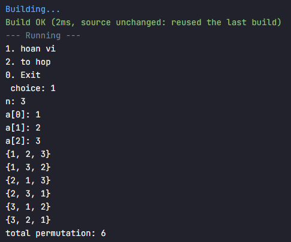

*Hình 1. Kết quả chạy thuật toán hoán vị (n = 3, mảng {1, 2, 3}).*

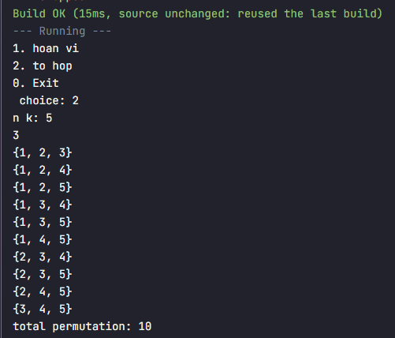

*Hình 2. Kết quả chạy thuật toán tổ hợp (n = 5, k = 3).*

## 4. Khó khăn và hướng giải quyết

Trong quá trình nghiên cứu, nhóm cần làm rõ sự khác biệt giữa việc sinh hoán vị và sinh tổ hợp, đặc biệt là cách xác định cấu hình kế tiếp theo thứ tự từ điển.

Đối với Algorithm L, trọng tâm là xác định pivot, chọn phần tử thay thế và hiểu vì sao có thể dùng thao tác đảo ngược (reverse) thay cho việc sắp xếp lại đoạn suffix.

Đối với Lexicographic Combination, trọng tâm là xác định giới hạn của từng vị trí và bảo đảm các phần tử phía sau luôn được đặt lại về giá trị nhỏ nhất hợp lệ.

Vì đây là bài tập nhóm, nhóm không chỉ chia việc cho nhanh mà còn muốn mỗi thành viên đều hiểu bản chất của toàn bộ đề tài, không chỉ riêng phần mình phụ trách. Nhóm trao đổi qua Discord để thống nhất các vấn đề cần giải quyết, quản lý mã nguồn bằng GitHub và kiểm tra chéo phần việc của nhau trước khi tổng hợp.

Nhóm sử dụng các ví dụ giải tay và kết quả chương trình để kiểm tra từng bước của thuật toán. Để ưu tiên việc hiểu rõ thuật toán, nhóm hạn chế tối đa việc sử dụng AI. Điều này khiến nhóm tốn thêm nhiều thời gian tìm hiểu trên các trang web và đọc kỹ tài liệu trước khi bắt đầu làm.

## 5. Kế hoạch tiếp theo

Sau khi báo cáo tuần 1 được duyệt, nhóm dự kiến thực hiện các mục đã lên kế hoạch cho tuần 2:
- Nghiên cứu và triển khai thuật toán sinh tập con bằng Gray Code.
- Giải thích vì sao hai tập con liên tiếp chỉ khác nhau đúng một phần tử.
- Kiểm thử chéo giữa các thành viên trong nhóm.
- Tích hợp ba thuật toán vào cùng một chương trình.

Tiếp theo, nhóm sẽ hoàn thiện CLI, xây dựng bộ kiểm thử tự động và phân tích độ phức tạp thuật toán.

## 6. Tổng kết

Trong tuần 1 của kế hoạch điều chỉnh, nhóm tập trung xây dựng lại thuật toán và tổ chức mã nguồn, triển khai và kiểm chứng đầy đủ hai thuật toán sinh cấu hình theo thứ tự từ điển. Các nội dung này sẽ là cơ sở để nhóm tiếp tục thực hiện Gray Code, tích hợp chương trình và đánh giá kết quả trong những giai đoạn tiếp theo.

## 7. Khai báo sử dụng AI

Trong tuần 1 này nhóm gần như không sử dụng bất kì công cụ LLM nào, chỉ sử dụng Search Engine của Google để nghiên cứu và tìm kiếm giải pháp cho đề bài được đưa ra.

**video minh chứng quá trình thực hiện dự án :** https://drive.google.com/file/d/1eT6iHTBMZKUkUi9EnYQ2bXtV02wnVezB/view?usp=sharing

---
# BÁO CÁO TIẾN ĐỘ (Tuần 2): Sinh tập con bằng Gray Code

**Môn học:** Cấu trúc dữ liệu và Giải thuật.

**Mã lớp học phần:** DASA230179_Dot1, HK1 2026-2027.

**Giảng viên hướng dẫn:** Huỳnh Xuân Phụng.

**GitHub Repository:** https://github.com/QuangquyNguyenvo/DSA_final_project

## 1. Tổng quan

### 1.1. Sinh tập con bằng Gray Code (Subset Generation via Gray Code)

Tiếp nối hai thuật toán Algorithm L và Lexicographic Combination đã triển khai trong tuần 1, nhóm tiếp tục nghiên cứu thuật toán sinh tập con bằng Gray Code.

Trong tuần 2 này, nhóm tập trung vào việc tìm hiểu nguyên lý hoạt động, review mã nguồn ban đầu, nghiên cứu phương pháp thay thế sử dụng các phép toán bitwise và xây dựng phương án kiểm chứng tính đúng đắn của thuật toán.

Mục tiêu của tuần này:
- Hoàn thiện thuật toán Gray Code Subset Generation.
- Giải thích tính chất hai tập con liên tiếp khác nhau đúng một phần tử.
- Phân tích và cải thiện cách biểu diễn trạng thái.
- Xây dựng test case kiểm chứng kết quả.
- Kiểm thử chéo và tích hợp thuật toán.

**Minh chứng:**
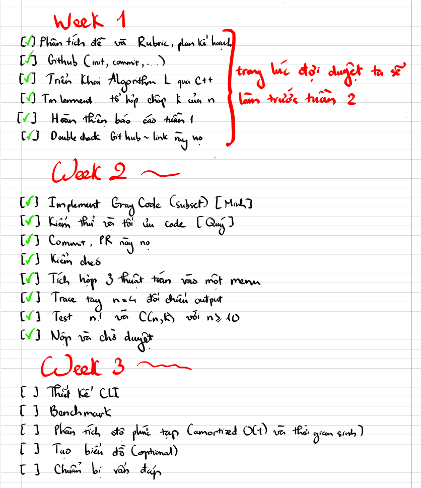

## 2. Công việc thực hiện

### 2.1. Nghiên cứu Gray Code

Gray Code là một phương pháp mã hoá nhị phân mà hai trạng thái liên tiếp khác nhau đúng một bit. Khác với hệ nhị phân thông thường, Gray Code ưu tiên thay đổi tối thiểu giữa các trạng thái thay vì sắp xếp mã theo thứ tự tăng dần. Đối với bài toán sinh tập con, mỗi bit đại diện cho trạng thái được chọn hoặc không được chọn của một phần tử. Vì vậy việc thay đổi một bit tương đương với việc thao tác thêm hoặc loại bỏ đúng một phần tử khỏi tập con hiện tại. [1], [4]

Với n phần tử, chương trình cần sinh đủ $2^n$ tập con khác nhau. Ví dụ với n = 3:

| i | Nhị phân thường của i | i >> 1 | Mã Gray G(i) | Thao tác |
|---|---|---|---|---|
| 0 | 000 | 000 | 000 | Khởi tạo (tập rỗng) |
| 1 | 001 | 000 | 001 | Lật bit 1, thêm phần tử 1 |
| 2 | 010 | 001 | 011 | Lật bit 2, thêm phần tử 2 |
| 3 | 011 | 001 | 010 | Lật bit 1, bớt phần tử 1 |
| 4 | 100 | 010 | 110 | Lật bit 3, thêm phần tử 3 |
| 5 | 101 | 010 | 111 | Lật bit 1, thêm phần tử 1 |
| 6 | 110 | 011 | 101 | Lật bit 2, bớt phần tử 2 |
| 7 | 111 | 011 | 100 | Lật bit 1, bớt phần tử 1 |


### 2.2. Phân tích mã nguồn ban đầu

Phiên bản ban đầu sử dụng một mảng số nguyên để lưu các bit của trạng thái hiện tại và một biến phụ để luân phiên hai trường hợp lựa chọn vị trí cần thay đổi.

#### Thuật toán hoạt động bằng cách:
- Khởi tạo trạng thái gồm n bit 0.
- Sử dụng biến tmp để chuyển đổi luân phiên hai quy tắc.
- Trường hợp 1: lật bit đầu tiên trong mảng.
- Trường hợp 2: tìm bit 1 đầu tiên theo chiều duyệt và lật bit ngay phía sau.
- Kết thúc khi không còn vị trí hợp lệ nào để thay đổi.

> Phương pháp này cập nhật trực tiếp trạng thái hiện tại, mỗi lần chỉ thay đổi một bit.

**Mã nguồn ban đầu:** https://github.com/QuangquyNguyenvo/DSA_final_project/blob/36f11ed/comb_gen.cpp#L25-L36

### 2.3. Nghiên cứu phương pháp Binary Reflected Gray Code

Sau khi phân tích phiên bản ban đầu, nhóm nghiên cứu thêm phương pháp Binary Reflected Gray Code. Phương pháp này có thể tính trực tiếp mã Gray dựa trên chỉ số nhị phân bằng công thức [3], [4]:

 G(i) = i ^ (i>>1)

Trong đó (các phép toán bit tham khảo từ [2], [5]):
- `i` : chỉ số của cấu hình cần sinh
- `>>1` : dịch bit sang phải một vị trí
- `^` : Phép XOR giữa các bit tương ứng.

> Công thức có thể hiểu thông qua quy tắc giữ nguyên bit đầu tiên, sau đó xác định các bit Gray còn lại bằng phép XOR giữa hai bit nhị phân kề nhau. Vì vậy, chương trình có thể tính trực tiếp mã Gray từ chỉ số i mà không cần duy trì mảng trạng thái của mã trước đó.

**Mã nguồn cải tiến:** https://github.com/QuangquyNguyenvo/DSA_final_project/blob/030871b/comb_gen.cpp#L38-L48

Ví dụ tính bộ nhớ với n = 10 (dùng cho bảng so sánh bên dưới):
- Ta có 1 byte = 8 bit và mỗi phần tử int tốn 4 byte tương đương 32 bit.
- Với mảng gồm 10 phần tử int thì sẽ tốn 40 byte tương đương 320 bit.

| Tiêu chí | Phiên bản ban đầu | Phương pháp Binary Reflected Gray Code |
|---|---|---|
| Biểu diễn dưới dạng | Mảng `vector<int>` gồm n phần tử, mỗi phần tử lưu một bit 0 hoặc 1 | Một số nguyên, mỗi bit của số đại diện cho một phần tử |
| Phương pháp | Sinh tuần tự từ trạng thái trước, dùng biến `tmp` (parity) để luân phiên hai quy tắc lật bit | Tính trực tiếp mã Gray thứ i bằng công thức `i ^ (i >> 1)` |
| Bộ nhớ | n × 4 byte (n = 10 thì tốn 40 byte) | 4 byte cố định cho một biến int |
| Worst-case (mỗi bước sinh) | O(n) do phải quét mảng để tìm bit 1 đầu tiên | O(1) cho việc tính mã (chưa tính thời gian in ra) |
| Khả năng mở rộng | Không bị giới hạn bởi độ rộng số nguyên, n chỉ phụ thuộc bộ nhớ | Bị giới hạn bởi độ rộng kiểu dữ liệu: int an toàn với n ≤ 30, dùng `long long` thì tối đa khoảng n ≤ 62 |


> Như vậy phương pháp XOR có lợi thế về cách biểu diễn dữ liệu và không cần quét mảng để tìm vị trí cần thay đổi. Tuy nhiên cái gì cũng có trade-off của nó, phương pháp ban đầu vẫn có ưu điểm khi cần xử lý các cấu hình có độ dài bit lớn hơn độ rộng của một số nguyên.

Việc so sánh tốc độ thực thi sẽ được thực hiện ở giai đoạn đánh giá hiệu năng.

## 3. Kiểm thử và kiểm chứng

### 3.1. Phương pháp kiểm chứng

Để đánh giá tính đúng đắn của thuật toán Gray Code, nhóm sử dụng các tiêu chí:

1. Mỗi mã phải nằm trong phạm vi biểu diễn của n bit.
2. Không có hai trạng thái bị trùng lặp.
3. Hai trạng thái liên tiếp phải khác nhau đúng 1 bit.
4. Tổng số mã sinh ra phải bằng $2^n$.

Điều kiện kiểm tra bằng phép XOR giữa trạng thái hiện tại và trạng thái trước đó. Nếu số lượng bit 1 trong kết quả XOR bằng đúng 1 thì bước chuyển thoả mãn tính chất Gray Code. Hàm `verifyGray()` được gọi cho từng mã ngay khi `graycode()` sinh ra và nhận đúng giá trị đã in, nên không tự sinh lại mã bằng công thức. Ba tiêu chí đầu được kiểm tra ở mỗi bước, tiêu chí 4 được kiểm tra khi kết thúc vòng lặp.

**Mã nguồn hàm verify:** https://github.com/QuangquyNguyenvo/DSA_final_project/blob/8494cf2/comb_gen.cpp#L37-L76

### 3.2. Các trường hợp kiểm thử


| Mã | Trường hợp | Đầu vào | Kết quả kỳ vọng | Kết quả thực tế | Trạng thái |
|---|-----|-----|---|---|---|
| TC01 | Biên n = 0 | n = 0 | 2^0 = 1 tập con (tập rỗng) | Sinh 1 tập con, `Tong so ma Gray: 1`, verify đúng | PASS |
| TC02 | n nhỏ nhất có phần tử | n = 1 | 2 mã: 0, 1 (tập rỗng và tập {1}) | Sinh `{ 0 }`, `{ 1 }`, `Tong so ma Gray: 2`, verify đúng | PASS |
| TC03 | Cơ bản | n = 2 | 4 mã: 00, 01, 11, 10 | Sinh đúng thứ tự 00, 01, 11, 10, `Tong so ma Gray: 4` | PASS |
| TC04 | Cơ bản (đối chiếu trace tay) | n = 3 | 8 mã: 000, 001, 011, 010, 110, 111, 101, 100 | Sinh đúng 8 mã, khớp với bảng trace tay ở mục 2.1 | PASS |
| TC05 | Kiểm tra tính phản xạ | n = 4 | 16 mã, nửa sau là nửa đầu đảo ngược và thêm bit 1 ở đầu | Sinh đúng 16 mã, mã thứ 8 là 0100 và mã thứ 9 là 1100 | PASS |
| TC06 | Kích thước trung bình | n = 10 | 2^10 = 1024 mã, các mã liên tiếp khác nhau đúng 1 bit | `Tong so ma Gray: 1024`, `Kiem tra Gray Code: DUNG` | PASS |
| TC07 | Kích thước lớn | n = 20 | 2^20 = 1 048 576 mã | `Tong so ma Gray: 1048576`, `Kiem tra Gray Code: DUNG` | PASS |
| TC08 | Dữ liệu không hợp lệ (âm) | n = -1 | Báo lỗi và quay lại menu | Báo `Loi: n phai thoa 0 <= n <= 30` và quay lại menu | PASS |
| TC09 | Vượt giới hạn int | n = 31 | Báo lỗi và quay lại menu | Báo `Loi: n phai thoa 0 <= n <= 30` và quay lại menu | PASS |

> Ở lần kiểm thử đầu tiên, TC08 và TC09 bị FAIL do chương trình crash (`std::bad_alloc`). Sau khi bổ sung kiểm tra đầu vào (xem mục 6), cả hai trường hợp đều PASS.


### 3.3. Giải thích tính chất Single-bit Difference

Hai mã Gray liên tiếp luôn khác nhau đúng một bit, tức là mỗi bước chỉ thêm hoặc bớt đúng một phần tử khỏi tập con hiện tại.

Xét hai chỉ số liên tiếp i và i + 1, gọi k là số bit 1 liên tiếp ở cuối của i. Khi cộng 1, k bit 1 này chuyển thành 0 và bit 0 ngay trước đó chuyển thành 1, nên `i ^ (i+1)` là một dãy (k+1) bit 1 liên tiếp ở cuối. Khi đó:

 G(i) ^ G(i+1) = (i ^ (i+1)) ^ ((i ^ (i+1)) >> 1)

Hai dãy bit 1 này lệch nhau một vị trí nên triệt tiêu nhau, chỉ còn lại đúng một bit 1.

Ví dụ với i = 3, i + 1 = 4:
- i ^ (i+1) = 011 ^ 100 = 111
- 111 ^ (111 >> 1) = 111 ^ 011 = 100, chỉ khác đúng một bit.
- Kiểm tra: G(3) = 010, G(4) = 110.

Đây cũng chính là điều kiện mà hàm `verifyGray()` kiểm tra bằng `__builtin_popcount(diff) == 1`.

### 3.4. Kiểm tra số lượng cấu hình với n ≥ 10

Theo yêu cầu đề bài, nhóm kiểm tra tổng số cấu hình của cả ba thuật toán với n ≥ 10 và đối chiếu với công thức lý thuyết.

| Mã | Thuật toán | Đầu vào | Kết quả kỳ vọng | Kết quả thực tế | Trạng thái |
|---|---|---|---|---|---|
| TC10 | Hoán vị | n = 10, mảng {1, 2, ..., 10} | 10! = 3 628 800 | `Tong so hoan vi: 3628800` | PASS |
| TC11 | Tổ hợp | n = 10, k = 5 | C(10, 5) = 252 | `Tong so to hop: 252` | PASS |
| TC12 | Tổ hợp | n = 20, k = 10 | C(20, 10) = 184 756 | `Tong so to hop: 184756` | PASS |
| TC13 | Tổ hợp, biên k = 0 | n = 10, k = 0 | C(10, 0) = 1 (tập rỗng) | `Tong so to hop: 1` | PASS |
| TC14 | Gray Code | n = 10 | 2^10 = 1 024 | `Tong so ma Gray: 1024` (xem TC06) | PASS |
| TC15 | Hoán vị, toàn phần tử trùng | n = 4, mảng {2, 2, 2, 2} | 1 hoán vị duy nhất | `Tong so hoan vi: 1` | PASS |

> TC15 là edge case "all-duplicate values" mà đề bài nêu. Algorithm L dùng so sánh `>=` khi tìm pivot nên tự bỏ qua các hoán vị trùng nhau và chỉ sinh đúng một cấu hình.

### 3.5. Trace tay Gray Code n = 4 và đối chiếu output

Theo góp ý của thầy ở tuần 1, nhóm trace tay trường hợp n = 4 bằng công thức `G(i) = i ^ (i >> 1)` rồi đối chiếu với output của chương trình.

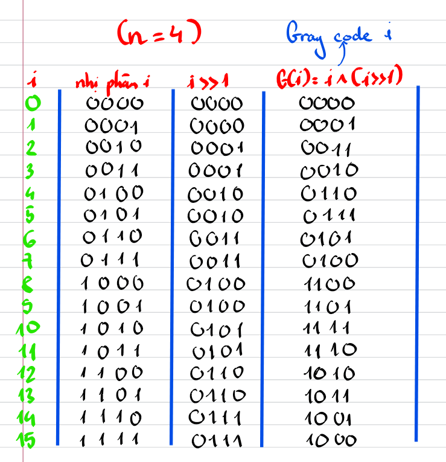

*Hình 3. Bảng trace tay Gray Code với n = 4.*

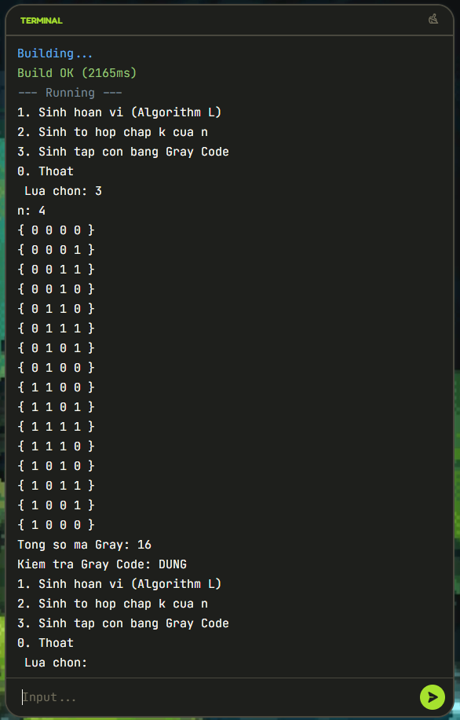

*Hình 4. Output của chương trình khi chọn menu 3 với n = 4.*

Kết quả: cả 16 mã trong bảng trace tay trùng khớp với output theo đúng thứ tự. Từ bảng trên có thể thấy thêm hai tính chất:
- Tính phản xạ: 8 mã cuối (i = 8 đến 15) là 8 mã đầu đọc ngược và thêm bit 1 ở đầu.
- Tần suất lật bit: trong 15 bước chuyển, bit 1 bị lật 8 lần, bit 2 lật 4 lần, bit 3 lật 2 lần và bit 4 lật 1 lần. Nhận xét này sẽ được dùng cho phần phân tích độ phức tạp khấu hao ở tuần 3.

## 4. Tích hợp và quản lý mã nguồn

Nhóm tiếp tục quản lý mã nguồn bằng GitHub theo quy trình: mỗi thành viên làm việc trên nhánh riêng, tạo Pull Request, thành viên còn lại review rồi mới merge vào nhánh `main`. Nhờ vậy mọi thay đổi đều được kiểm tra chéo trước khi tích hợp và lịch sử phát triển được lưu lại rõ ràng.

**Mã nguồn Gray Code:**
- Phiên bản ban đầu (`legacyNextGray`), cập nhật trực tiếp mảng trạng thái: https://github.com/QuangquyNguyenvo/DSA_final_project/blob/030871b/comb_gen.cpp#L25-L36

- Phiên bản cải tiến (`graycode`), tính trực tiếp bằng `G(i) = i ^ (i >> 1)`: https://github.com/QuangquyNguyenvo/DSA_final_project/blob/030871b/comb_gen.cpp#L38-L48


**Mã nguồn Verify:**
- Hàm `verifyGray()` kiểm tra phạm vi, trùng lặp, khác đúng 1 bit và tổng số mã bằng 2^n:
  - Phiên bản đầu (sinh lại mã bằng công thức): https://github.com/QuangquyNguyenvo/DSA_final_project/blob/030871b/comb_gen.cpp#L50-L76
  - Phiên bản sau khi sửa (kiểm tra trực tiếp từng mã `graycode()` sinh ra): https://github.com/QuangquyNguyenvo/DSA_final_project/blob/8494cf2/comb_gen.cpp#L37-L76

**Pull Request:**
- PR #3 (`week2`, Đào Nghiệm Minh): triển khai Gray Code phiên bản ban đầu và khung README tuần 2: https://github.com/QuangquyNguyenvo/DSA_final_project/pull/3

- PR #4 (`feature/graycode`, Nguyễn Võ Quang Quý): cải tiến Gray Code bằng bitwise, thêm hàm verify và bổ sung báo cáo: https://github.com/QuangquyNguyenvo/DSA_final_project/pull/4

- PR #5 (`week2`, Đào Nghiệm Minh): chỉnh sửa README tuần 2 và thêm bảng hand trace: https://github.com/QuangquyNguyenvo/DSA_final_project/pull/5

- PR #6 (`feature/graycode`, Nguyễn Võ Quang Quý): chặn đầu vào không hợp lệ, cho `verifyGray()` kiểm tra trực tiếp output, thống nhất thông báo, bổ sung test n ≥ 10 và trace tay n = 4: https://github.com/QuangquyNguyenvo/DSA_final_project/pull/6

**Commit:**
- [`36f11ed`](https://github.com/QuangquyNguyenvo/DSA_final_project/commit/36f11ed): thêm phần Gray Code và README mới (Minh).
- [`9f53273`](https://github.com/QuangquyNguyenvo/DSA_final_project/commit/9f53273): tối ưu sinh Gray Code bằng thao tác bitwise (Quý).
- [`b2bf47f`](https://github.com/QuangquyNguyenvo/DSA_final_project/commit/b2bf47f): bổ sung README báo cáo tuần 2 (Quý).
- [`030871b`](https://github.com/QuangquyNguyenvo/DSA_final_project/commit/030871b): merge PR #4, tích hợp Gray Code.
- [`4f30369`](https://github.com/QuangquyNguyenvo/DSA_final_project/commit/4f30369): sửa README tuần 2, thêm bảng hand trace (Minh).
- [`3d30835`](https://github.com/QuangquyNguyenvo/DSA_final_project/commit/3d30835): chặn n không hợp lệ ở menu Gray Code (Quý).
- [`945b627`](https://github.com/QuangquyNguyenvo/DSA_final_project/commit/945b627): đổi tên hàm sang tiếng Anh, thống nhất thông báo và sửa chính tả menu (Quý).
- [`8494cf2`](https://github.com/QuangquyNguyenvo/DSA_final_project/commit/8494cf2): cho `verifyGray()` kiểm tra trực tiếp từng mã mà `graycode()` sinh ra (Quý).

Theo góp ý của thầy ở tuần 1, nhóm thống nhất từ nay đặt message commit theo dạng `loại: mô tả ngắn`, trong đó `feat:` cho tính năng mới, `fix:` cho sửa lỗi, `docs:` cho báo cáo và README, `refactor:` cho chỉnh sửa mã nguồn không làm thay đổi chức năng.

Sau tuần 2, chương trình `comb_gen.cpp` đã tích hợp ba thuật toán trong cùng một menu: sinh hoán vị (Algorithm L), sinh tổ hợp chập k của n và sinh tập con bằng Gray Code. Lựa chọn Gray Code tự động đưa từng mã vừa sinh qua `verifyGray()` để kiểm chứng.


## 5. Phân công công việc

| Thành viên | MSSV | Công việc tuần 2 |
|---|---|---|
| Đào Nghiệm Minh | 25110042 | - Tìm hiểu và triển khai Gray Code phiên bản ban đầu.<br>- Hỗ trợ kiểm thử các test case.<br>- Tích hợp chương trình.<br>- Viết và tổng hợp báo cáo. |
| Nguyễn Võ Quang Quý | 25110055 | - Review mã nguồn.<br>- Nghiên cứu phương pháp XOR.<br>- Phân tích thiết kế.<br>- Cải tiến mã nguồn.<br>- Xây dựng hàm kiểm thử.<br>- Viết và tổng hợp báo cáo. |
| Cả nhóm | | - Kiểm tra chéo mã nguồn và báo cáo.<br>- Nộp bài. |


## 6. Khó khăn và hướng giải quyết

- Hiểu quy tắc luân phiên của phiên bản ban đầu: khó giải thích vì sao biến `tmp` luân phiên hai quy tắc lật bit lại sinh đúng thứ tự Gray. Nhóm giải quyết bằng cách trace tay với n = 3 và n = 4.
- Thống nhất thứ tự bit: bản ban đầu lưu `a[0]` là bit thấp nhất, còn `graycode()` in từ bit cao xuống nên kết quả trông như bị đảo ngược. Nhóm thống nhất bit 1 là bit ngoài cùng bên phải.
- Đầu vào không hợp lệ: n = -1 và n = 31 làm chương trình crash do `1 << n` không hợp lệ hoặc tràn `int`. Nhóm đã bổ sung kiểm tra 0 ≤ n ≤ 30 ở menu Gray Code.
- Xuất dữ liệu lớn: n = 20 in hơn một triệu dòng nên rất chậm. Nhóm tạm kiểm tra qua dòng tổng số mã và kết quả `verifyGray()`, tuần 3 sẽ bổ sung giới hạn số cấu hình được in.
- Hàm kiểm chứng chưa độc lập: phiên bản đầu của `verifyGray()` sinh lại mã bằng cùng công thức với hàm sinh nên không kiểm tra được output thật. Nhóm đã sửa để `graycode()` đưa từng mã vừa sinh vào `verifyGray()`. Khi thử cố tình đổi công thức sinh thành `gray = i`, chương trình báo `Kiem tra Gray Code: SAI`.

## 7. Kế hoạch tuần 3
- Hoàn thiện CLI theo yêu cầu đề bài.
- Hỗ trợ in giới hạn số cấu hình đầu tiên.
- Phân tích worst-case, amortized complexity (phân tích khấu hao) và tổng thời gian sinh.
- Benchmark và so sánh hiệu năng.
- Hoàn thiện báo cáo kỹ thuật và Self-Explanation.
- Chuẩn bị cho phần vấn đáp đề tài.

## 8. Khai báo sử dụng AI và nguồn tài liệu tham khảo

### 8.1. Khai báo sử dụng AI và nguồn gốc kiến thức

Nhóm không sử dụng công cụ AI trong quá trình nghiên cứu, viết mã nguồn và viết báo cáo. Tương tự tuần 1, nhóm chỉ sử dụng Search Engine của Google để tìm kiếm và tra cứu tài liệu, từ đó tìm được các nguồn tham khảo được liệt kê ở mục 8.2. Toàn bộ quá trình thực hiện được quay video minh chứng (xem bên dưới). Các kiến thức sử dụng trong báo cáo đến từ những nguồn sau, và được đánh dấu [1]-[5] tại vị trí sử dụng trong báo cáo, tương ứng với danh sách ở mục 8.2.

Các kiến thức nền tảng về Gray Code, biểu diễn nhị phân và tính chất thay đổi một bit giữa hai trạng thái liên tiếp đã được nhóm tiếp cận trong học phần Toán rời rạc và Lý thuyết đồ thị, đặc biệt thông qua nội dung Boolean Algebra và Karnaugh Map (K-map).

Các thao tác bitwise như XOR, AND, OR và dịch bit cũng là những kiến thức lập trình đã được tiếp cận từ trước và tiếp tục được sử dụng trong quá trình luyện tập lập trình thi đấu, bao gồm ôn tập ICPC tại trường.

**Video minh chứng quá trình thực hiện tuần 2**

- **Nguyễn Võ Quang Quý:** [Xem video](https://drive.google.com/file/d/1zdsthhp6V-TzWV5NbmcEFX3qUSoUhG5G/view)
- **Đào Nghiệm Minh:** [Xem video](https://drive.google.com/file/d/1R3uiYg4pMr_WFpjEqWWMRmxVvOA08siG/view)

### 8.2. Tài liệu tham khảo

**[1] Học phần Toán rời rạc và Lý thuyết đồ thị (Discrete Mathematics and Graph Theory)**

Trường Đại học Công nghệ Kỹ thuật TP.HCM (HCMUTE).

Nội dung liên quan: Boolean Algebra, Karnaugh Map (K-map), biểu diễn nhị phân và các tính chất của Gray Code.

**[2] VNOI Wiki: Phép toán bit**

[https://wiki.vnoi.info/algo/basic/bitwise-operators](https://wiki.vnoi.info/algo/basic/bitwise-operators)

Nội dung liên quan: Các toán tử bitwise, XOR, phép dịch bit và ứng dụng trong lập trình.

**[3] GeeksforGeeks: Generate n-bit Gray Codes**

[https://www.geeksforgeeks.org/dsa/generate-n-bit-gray-codes/](https://www.geeksforgeeks.org/dsa/generate-n-bit-gray-codes/)

Nội dung liên quan: Các phương pháp sinh Gray Code, công thức `G(i) = i ^ (i >> 1)` và ví dụ sinh mã Gray bằng thao tác bitwise.

**[4] CP-Algorithms: Gray Code**

[https://cp-algorithms.com/algebra/gray-code.html](https://cp-algorithms.com/algebra/gray-code.html)

Nội dung liên quan: Binary Reflected Gray Code, công thức chuyển đổi giữa mã nhị phân và mã Gray, cùng các tính chất của dãy Gray Code.

**[5] Viblo: Thao tác xử lý bit và ứng dụng (Bit Manipulation)**

[https://viblo.asia/p/thao-tac-xu-ly-bit-va-ung-dung-bit-manipulation-3kY4gxl9JAe](https://viblo.asia/p/thao-tac-xu-ly-bit-va-ung-dung-bit-manipulation-3kY4gxl9JAe)

Nội dung liên quan: Các thao tác xử lý bit và ứng dụng trong lập trình.

---
# BÁO CÁO TIẾN ĐỘ (Tuần 3): Hoàn thiện CLI, phân tích độ phức tạp và đánh giá hiệu năng

**Môn học:** Cấu trúc dữ liệu và Giải thuật.

**Mã lớp học phần:** DASA230179_Dot1, HK1 2026-2027.

**Giảng viên hướng dẫn:** Huỳnh Xuân Phụng.

**GitHub Repository:** https://github.com/QuangquyNguyenvo/DSA_final_project

## 1. Tổng quan

Sau hai tuần đầu, `comb_gen.cpp` đã có đủ ba thuật toán. Sang tuần 3, nhóm chuyển trọng tâm từ cài đặt sang hoàn thiện chương trình và đánh giá thuật toán.

Mục tiêu của tuần này:
- Hoàn thiện CLI: menu rõ ràng, tô màu kết quả, kiểm tra dữ liệu đầu vào cho cả ba thuật toán.
- Phân tích trường hợp xấu nhất, chi phí khấu hao (amortized) mỗi bước và tổng thời gian sinh của từng thuật toán.
- Xây dựng benchmark, đo thời gian chạy thực tế và đối chiếu với kết quả phân tích lý thuyết.
- Bổ sung kiểm thử cho sinh hoán vị và sinh tổ hợp (tuần 2 mới kiểm thử Gray Code), gồm trace tay, trường hợp biên và dữ liệu lớn.

**Minh chứng:**
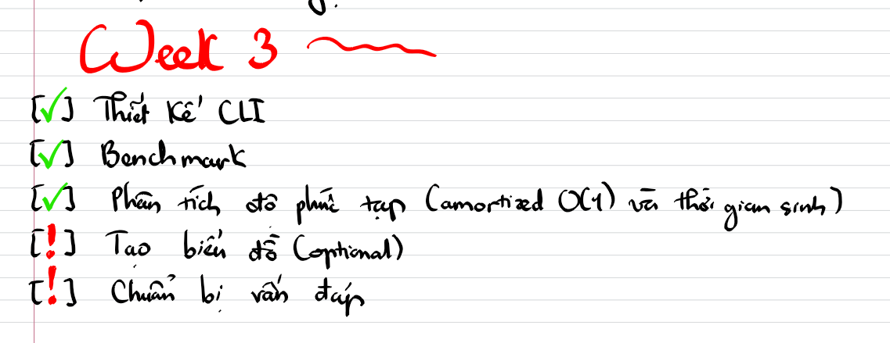

## 2. Công việc thực hiện

### 2.1. Thiết kế CLI

Chương trình `comb_gen.cpp` chạy trên terminal với một menu lặp lại liên tục: người dùng chọn chức năng, nhập dữ liệu, xem kết quả, rồi quay lại menu cho tới khi chọn **0. Thoat**.

```
===========COMBINATION GENERATOR===========
     1. Sinh hoan vi (Algorithm L)
     2. Sinh to hop chap k cua n
     3. Sinh tap con bang Gray Code
     4. Benchmark
     0. Thoat
============================================
  -> Lua chon:
```

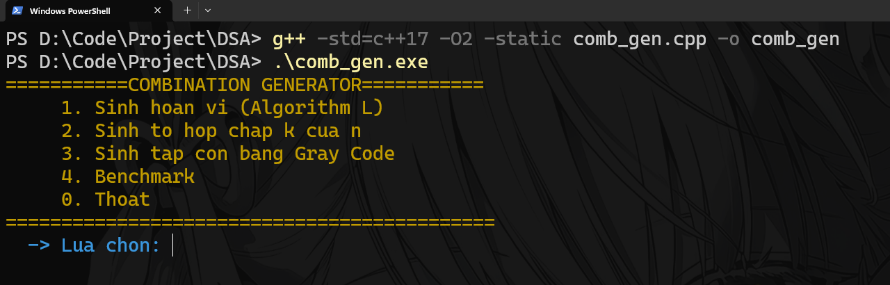

**Tô màu bằng mã ANSI escape [1]:**

| Mã | Màu | Dùng cho |
|---|---|---|
| `\033[33m` | Vàng | Tiêu đề, menu và các đường viền `====` |
| `\033[36m` | Xanh lơ | Dòng nhắc lựa chọn, tổng số cấu hình, kết quả kiểm tra Gray Code DUNG |
| `\033[31m` | Đỏ | Kết quả kiểm tra Gray Code SAI |
| `\033[0m` | | Trả về màu mặc định sau mỗi dòng |

Các dòng `----` ngăn cách phần nhập dữ liệu với phần kết quả cho dễ đọc. Màu chỉ hiển thị đúng trên terminal hỗ trợ ANSI (như Windows Terminal, terminal của VS Code). Terminal cũ không hỗ trợ sẽ in nguyên các mã như `[33m`.

**Nhập dữ liệu và kiểm tra đầu vào:**

| Lựa chọn | Dữ liệu nhập | Điều kiện hợp lệ | Lý do giới hạn |
|---|---|---|---|
| 1. Hoán vị | n, rồi lần lượt n phần tử | 0 ≤ n ≤ 10 | n âm có thể gây crash, n lớn in quá nhiều dòng (10! ≈ 3,6 triệu) |
| 2. Tổ hợp | n, rồi k (chọn k phần tử từ {1, ..., n}) | 0 ≤ k ≤ n ≤ 20 | k > n không có tổ hợp, n lớn in quá nhiều dòng |
| 3. Gray Code | n | 0 ≤ n ≤ 30 | n âm làm `1 << n` không hợp lệ, n > 30 làm `1 << n` tràn `int` |

- Nhập sai điều kiện thì chương trình báo lỗi (ví dụ `Loi: n phai thoa 0 <= n <= 30`) và quay lại menu.
- Nhập chữ thay vì số ở menu thì chương trình thoát vòng lặp và kết thúc.
- Với hoán vị, các phần tử nhập vào được sắp xếp trước, để bắt đầu sinh từ hoán vị nhỏ nhất theo thứ tự từ điển.

**Hiển thị kết quả:**

- Mỗi cấu hình in trên một dòng: hoán vị và tổ hợp dạng `{1, 2, 3}`, Gray Code dạng dãy bit `{ 0 1 1 }`.
- Cuối mỗi lần chạy in tổng số cấu hình (`Tong so hoan vi`, `Tong so to hop`, `Tong so ma Gray`) để đối chiếu với n!, C(n, k), 2ⁿ.
- Gray Code in thêm kết quả kiểm tra của `verifyGray()`: `Kiem tra Gray Code: DUNG` (xanh) hoặc `SAI` (đỏ).
- Lựa chọn **4. Benchmark** chạy phần đo hiệu năng, trình bày ở mục 2.3.

**Mã nguồn hàm `main`:** https://github.com/QuangquyNguyenvo/DSA_final_project/blob/faf925f/comb_gen.cpp#L90-L165

---

### 2.2. Phân tích độ phức tạp

#### Nguyên tắc chung

Cả 3 thuật toán đều dùng chung một cách tính [3], [4], [7]:

> **Tổng thời gian = (số lần vòng lặp chạy) × (chi phí hàm sinh kế tiếp + chi phí `print`)**

Số lần lặp nằm ở vòng `do while` hoặc `for` trong `main` hay `graycode`. Chi phí mỗi bước nằm trong các vòng `while`, `for` và lệnh `reverse` bên trong hàm sinh. Số dòng dưới đây tính theo mã nguồn ở commit [`faf925f`](https://github.com/QuangquyNguyenvo/DSA_final_project/blob/faf925f/comb_gen.cpp).

---

#### 2.2.1. Sinh hoán vị: `nextPermutation`

**Số lần lặp:** vòng `do while` ở **dòng 117 đến 120** chạy **n!** lần (nếu các phần tử khác nhau đôi một).

**Chi phí mỗi lần gọi:**

| Dòng | Đoạn code | Trường hợp xấu nhất |
|---|---|---|
| 10 | `while(i>=0 && a[i]>=a[i+1]) i--;` (tìm pivot) | O(n) |
| 14 | `while(a[j]<=a[i]) j--;` (tìm phần tử thay thế) | O(n) |
| 17 | `reverse(a.begin()+i+1, a.end());` | O(n) |

- Trường hợp xấu nhất mỗi bước là **O(n)**, xảy ra khi pivot nằm ở đầu dãy (ví dụ đi từ {1, 4, 3, 2} sang {2, 1, 3, 4}).
- Tính trung bình (amortized) thì chỉ **O(1)** [5], vì phần lớn các lần gọi có pivot nằm ngay gần cuối dãy. Ở bảng trace n = 3 (mục 3.1), trong 5 lần sinh có 3 lần pivot nằm ở vị trí áp chót, chỉ 2 lần phải lùi về đầu dãy. Pivot càng nằm xa cuối dãy thì trường hợp đó càng hiếm, nên số bước trung bình bị chặn bởi một hằng số nhỏ. Số liệu ở Bảng 1 (mục 2.3) phù hợp với nhận định này: thời gian sinh một hoán vị gần như không đổi khi n tăng từ 8 đến 12.
- `print(a)` ở dòng 118 tốn **O(n)**.
- `sort` ở dòng 114 tốn O(n log n) nhưng chỉ chạy một lần, nên không đáng kể.

>**Kết luận:** Thời gian **O(n · n!)**, bị chi phối bởi việc in. Nếu không in thì là **O(n!)**. Bộ nhớ **O(n)**.

**Mã nguồn:** https://github.com/QuangquyNguyenvo/DSA_final_project/blob/faf925f/comb_gen.cpp#L8-L19

---

#### 2.2.2. Sinh tổ hợp chập k của n: `nextCombination`

**Số lần lặp:** vòng `do while` ở **dòng 139 đến 142** chạy **C(n, k)** lần.

**Chi phí mỗi lần gọi:**

| Dòng | Đoạn code | Trường hợp xấu nhất |
|---|---|---|
| 23 | `while(i>=0 && a[i]==n-k+i+1) i--;` (bỏ qua các vị trí đã đạt tối đa) | O(k) |
| 26 | `for(int j=i+1;j<k;j++) a[j]=a[j-1]+1;` (đặt lại phần đuôi) | O(k) |

- Xấu nhất **O(k)** mỗi bước, ví dụ đi từ {1, 4, 5} sang {2, 3, 4} với n = 5, k = 3.
- Trung bình gần như hằng số khi k ≤ n/2, vì đa số lần chỉ có phần tử cuối tăng lên. Số liệu benchmark ở mục 2.3 (k = n/2) cũng cho thấy thời gian sinh mỗi cấu hình gần như không đổi khi n tăng.
- `print(a)` ở dòng 140 tốn **O(k)**.

>**Kết luận:** Thời gian **O(k · C(n, k))**. Nếu không in thì là **O(C(n, k))** khi k ≤ n/2. Bộ nhớ **O(k)**.

**Mã nguồn:** https://github.com/QuangquyNguyenvo/DSA_final_project/blob/faf925f/comb_gen.cpp#L20-L28

---

#### 2.2.3. Sinh tập con bằng Gray Code: `graycode`

**Số lần lặp:** vòng `for` ở **dòng 68** chạy **2ⁿ** lần.

**Chi phí mỗi vòng:**

| Dòng | Đoạn code | Chi phí |
|---|---|---|
| 69 | `int gray= i^(i>>1);` | O(1) |
| 71 | `for(int j=n-1; j>=0;j--)` in từng bit | **O(n)**, chi phí chính |
| 74, hàm `verifyGray` (dòng 43 đến 59) | tra mảng `seen` và `__builtin_popcount` | O(1) |

**Bộ nhớ:** `vector<bool> seen(total, false)` ở **dòng 63** tốn **O(2ⁿ)**. Đây là chỗ duy nhất trong 3 thuật toán có bộ nhớ tăng theo hàm mũ, và nó chỉ phục vụ việc kiểm tra, không phục vụ việc sinh mã.

>**Kết luận:** Thời gian **O(n · 2ⁿ)** do in, phần sinh mã chỉ **O(1)** mỗi bước, không cần khấu hao. Bộ nhớ **O(2ⁿ)** (bỏ phần kiểm tra thì chỉ còn O(1)).

**Ghi chú:** Hàm `legacyNextGray` (dòng 29) không được gọi trong `main`. Nếu dùng nó, vòng `while` ở dòng 33 tốn O(n) mỗi bước trong trường hợp xấu nhất.

**Mã nguồn:**
- Hàm `graycode`: https://github.com/QuangquyNguyenvo/DSA_final_project/blob/faf925f/comb_gen.cpp#L61-L80
- Hàm `verifyGray`: https://github.com/QuangquyNguyenvo/DSA_final_project/blob/faf925f/comb_gen.cpp#L43-L59

---

**Tóm tắt:**

| Thuật toán | Số lần lặp (dòng) | Chi phí mỗi bước (dòng) | Tổng thời gian | Bộ nhớ |
|---|---|---|---|---|
| Hoán vị | n! (117) | O(n) xấu nhất, O(1) khấu hao (10, 14, 17) | O(n · n!) | O(n) |
| Tổ hợp chập k | C(n, k) (139) | O(k) xấu nhất, O(1) khấu hao khi k ≤ n/2 (23, 26) | O(k · C(n, k)) | O(k) |
| Gray Code | 2ⁿ (68) | O(1) sinh mã (69), O(n) do in (71) | O(n · 2ⁿ) | O(2ⁿ) (63) |

>**Nhận xét:** Số lần lặp của cả 3 thuật toán bằng đúng số cấu hình cần sinh (n!, C(n, k), 2ⁿ). Muốn in hết các cấu hình thì ít nhất phải lặp chừng đó lần, nên số lần lặp không thể giảm thêm. Hệ số n hoặc k nhân thêm là do mỗi cấu hình có n hoặc k phần tử cần in ra.

---

### 2.3. Đánh giá hiệu năng (Benchmark)

#### 2.3.1. Mục tiêu

Dùng số liệu đo thật để kiểm tra hai kết luận ở mục 2.2:
- Tổng thời gian tăng đúng theo n!, C(n, k), 2ⁿ.
- Thời gian sinh một cấu hình gần như không đổi khi n tăng (O(1) khấu hao).

#### 2.3.2. Môi trường đo

Bảng 1 và Bảng 2 đo trên máy của Minh bằng bản benchmark đầu (commit `edbfebe`). Bảng 3 được đo lại trên máy của Quý bằng bản viết lại (commit `1a2a6f6`), sau khi sửa lỗi phép đo Gray Code (xem mục 2.3.3 và mục 6). Hai máy dùng cùng CPU, chỉ khác dung lượng RAM, phiên bản trình biên dịch và cờ `-static`.

| Thành phần | Máy 1 (Bảng 1, 2) | Máy 2 (Bảng 3) |
|---|---|---|
| CPU | Intel Core i7-11800H (11th Gen), 8 nhân / 16 luồng, 2.30 GHz | Intel Core i7-11800H (11th Gen), 8 nhân / 16 luồng, 2.30 GHz |
| RAM | 8 GB | 16 GB |
| Trình biên dịch | g++ 12.1.0 (MinGW-W64 x86_64, posix-seh) | g++ 16.2.0 (MinGW-W64 x86_64, ucrt-posix-seh) |
| Cờ biên dịch | `g++ -std=c++17 -O2 comb_gen.cpp -o comb_gen` | `g++ -std=c++17 -O2 -static comb_gen.cpp -o comb_gen` |
| Đồng hồ đo | `std::chrono::steady_clock` [2], [6] | `std::chrono::steady_clock` [2], [6] |

#### 2.3.3. Phương pháp đo

**Tổ chức mã nguồn:** toàn bộ benchmark nằm trong file header `benchmark.h`, được `#include` vào `comb_gen.cpp` và gọi bằng lựa chọn **4. Benchmark** trên menu. File gồm các hàm:

| Hàm | Dòng | Chức năng |
|---|---|---|
| `fact`, `binom` | 13 đến 23 | Tính số cấu hình theo công thức n! và C(n, k) |
| `generate` | 26 đến 45 | Sinh toàn bộ cấu hình nhưng không in, trả về số cấu hình đếm được |
| `measure` | 48 đến 58 | Chạy 1 lần khởi động và 5 lần đo, trả về median |
| `runAlgo` | 61 đến 89 | Đo một thuật toán với n chạy trong một khoảng, in và ghi từng dòng kết quả |
| `runBenchmark` | 91 đến 101 | Gọi `runAlgo` cho 3 thuật toán và ghi file `bench_results.csv` |

**Mã nguồn:** https://github.com/QuangquyNguyenvo/DSA_final_project/blob/c703bcb/benchmark.h

**Gọi đúng hàm của chương trình:** benchmark gọi luôn `nextPermutation` và `nextCombination` trong `comb_gen.cpp`, nên đo đúng code đã nộp. Gray Code dùng đúng công thức `i ^ (i >> 1)` như menu 3.

**Chỉ đo phần sinh:** không tính thời gian in. Với Gray Code, benchmark cũng không tính `verifyGray()`, vì việc kiểm tra đúng sai đã được thực hiện ở menu 3. Biến `grayXor` giữ lại kết quả các mã Gray, nếu không có biến này thì trình biên dịch sẽ bỏ luôn vòng lặp khi tối ưu `-O2`.

**Kiểm tra số lượng:** mỗi lần chạy đều đếm số cấu hình sinh ra và so với n!, C(n, k), 2ⁿ. Nếu không khớp thì chương trình in `SAI SO LUONG`. Tất cả các dòng đều khớp.

**Lặp lại:** mỗi bộ dữ liệu chạy 1 lần khởi động (không ghi nhận), sau đó chạy 5 lần và lấy **trung vị (median)**.

**Hai phiên bản benchmark:** bản đầu do Minh viết ([`edbfebe`](https://github.com/QuangquyNguyenvo/DSA_final_project/blob/edbfebe/benchmark.h)), sau đó Quý review và viết lại ([`1a2a6f6`](https://github.com/QuangquyNguyenvo/DSA_final_project/blob/1a2a6f6/benchmark.h)). Các thay đổi:

| Nội dung | Bản đầu (`edbfebe`) | Bản viết lại (`1a2a6f6`) |
|---|---|---|
| Tổ chức mã | Mỗi thuật toán một hàm riêng (`genPerm`, `genComb`, `genGray`), đo qua template `medianMs` và lambda | Gộp vào một hàm `generate`, đo qua `measure` và `runAlgo`, mã ngắn và dễ đọc hơn |
| Đo hoán vị | Sinh từ {1, ..., n}, đếm số cấu hình, gọi `nextPermutation` | Giữ nguyên cách đo |
| Đo tổ hợp | Sinh từ {1, ..., k}, đếm số cấu hình, gọi `nextCombination` | Giữ nguyên cách đo |
| Đo Gray Code | Gọi `verifyGray()` cho mỗi mã nhưng không dùng kết quả trả về | Bỏ `verifyGray()`, XOR các mã Gray vào biến `grayXor` để trình biên dịch không bỏ vòng lặp |
| Đếm số cấu hình | Biến toàn cục `bCnt` | `generate` trả về số cấu hình đếm được |
| Bảng kết quả dùng trong báo cáo | Bảng 1, Bảng 2 | Bảng 3 |

Vì cách đo hoán vị và tổ hợp không đổi giữa hai phiên bản, Bảng 1 và Bảng 2 đo bằng bản đầu vẫn dùng được. Chỉ phép đo Gray Code phải đo lại.

**Các cột trong bảng kết quả** (cũng được ghi vào `bench_results.csv` để vẽ biểu đồ ở tuần 4):
  - `total_ms`: tổng thời gian sinh toàn bộ cấu hình (median).
  - `ns/cấu hình` = total_ms × 1 000 000 / số cấu hình, tức thời gian sinh một cấu hình.
  - `Tỉ lệ thời gian` và `Tỉ lệ công thức`: thời gian và số cấu hình của dòng này chia cho dòng trước. Hai tỉ lệ gần bằng nhau nghĩa là thời gian tăng đúng theo công thức.

#### 2.3.4. Bộ dữ liệu thử

| Thuật toán | Đầu vào | Lý do chọn |
|---|---|---|
| Hoán vị | n = 8 đến 12, mảng {1, ..., n} | 12! ≈ 4,8 × 10⁸ chạy trong khoảng 1,4 giây, 13! lâu hơn khoảng 13 lần |
| Tổ hợp | n = 16 đến 30 (bước 2), k = n/2 | k = n/2 cho C(n, k) lớn nhất ứng với mỗi n, và n chẵn để k đúng bằng một nửa n |
| Gray Code | n = 16 đến 28 (bước 2) | 2²⁸ ≈ 2,7 × 10⁸ mã, mỗi lần n tăng 2 thì số mã gấp 4 nên dễ đối chiếu |

#### 2.3.5. Kết quả

**Bảng 1. Hoán vị (Algorithm L), máy 1**

| n | Số cấu hình (n!) | total_ms (median) | ns/cấu hình | Tỉ lệ thời gian | Tỉ lệ công thức |
|---|---|---|---|---|---|
| 8 | 40 320 | 0,122 | 3,03 | | |
| 9 | 362 880 | 1,087 | 2,99 | 8,91 | 9 |
| 10 | 3 628 800 | 11,13 | 3,07 | 10,24 | 10 |
| 11 | 39 916 800 | 117,5 | 2,94 | 10,56 | 11 |
| 12 | 479 001 600 | 1 393 | 2,91 | 11,86 | 12 |

**Bảng 2. Tổ hợp chập k của n (k = n/2), máy 1**

| n | k | Số cấu hình C(n, k) | total_ms (median) | ns/cấu hình | Tỉ lệ thời gian | Tỉ lệ công thức |
|---|---|---|---|---|---|---|
| 16 | 8 | 12 870 | 0,034 | 2,63 | | |
| 18 | 9 | 48 620 | 0,130 | 2,68 | 3,85 | 3,78 |
| 20 | 10 | 184 756 | 0,495 | 2,68 | 3,80 | 3,80 |
| 22 | 11 | 705 432 | 1,893 | 2,68 | 3,83 | 3,82 |
| 24 | 12 | 2 704 156 | 7,222 | 2,67 | 3,81 | 3,83 |
| 26 | 13 | 10 400 600 | 27,37 | 2,63 | 3,79 | 3,85 |
| 28 | 14 | 40 116 600 | 106,5 | 2,65 | 3,89 | 3,86 |
| 30 | 15 | 155 117 520 | 416,1 | 2,68 | 3,91 | 3,87 |

**Bảng 3. Gray Code (chỉ sinh mã, không kiểm tra), máy 2**

| n | Số cấu hình (2ⁿ) | total_ms (median) | ns/cấu hình | Tỉ lệ thời gian | Tỉ lệ công thức |
|---|---|---|---|---|---|
| 16 | 65 536 | 0,029 | 0,45 | | |
| 18 | 262 144 | 0,118 | 0,45 | 4,01 | 4 |
| 20 | 1 048 576 | 0,471 | 0,45 | 4,00 | 4 |
| 22 | 4 194 304 | 1,887 | 0,45 | 4,01 | 4 |
| 24 | 16 777 216 | 7,865 | 0,47 | 4,17 | 4 |
| 26 | 67 108 864 | 31,48 | 0,47 | 4,00 | 4 |
| 28 | 268 435 456 | 125,6 | 0,47 | 3,99 | 4 |

Output khi chọn menu 4 trên máy 2 (Bảng 3 lấy từ lần chạy này) và file [`bench_results.csv`](https://github.com/QuangquyNguyenvo/DSA_final_project/blob/dbce015/bench_results.csv) được ghi ra:

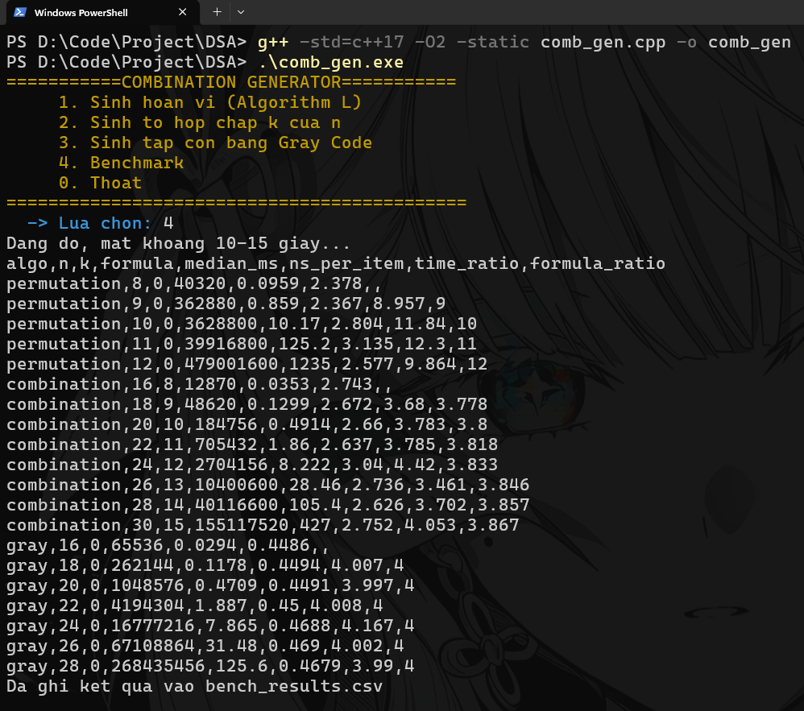

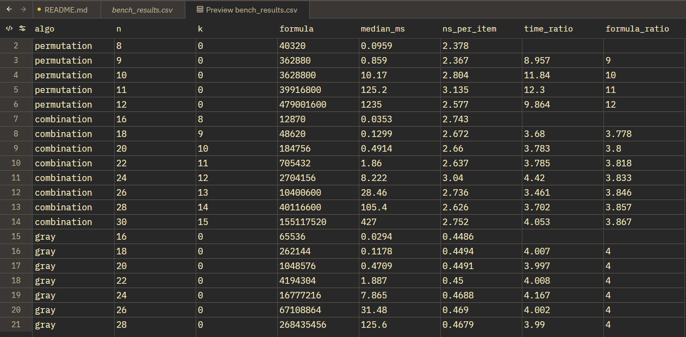

#### 2.3.6. Phân tích và nhận xét

**Kỳ vọng theo lý thuyết** (dùng để đối chiếu với số liệu ở 2.3.5):

| Thuật toán | Tổng thời gian (không in) | Tỉ lệ kỳ vọng khi tăng n | ns/cấu hình |
|---|---|---|---|
| Hoán vị | Θ(n!) | t(n+1) / t(n) ≈ n + 1 | Gần như không đổi |
| Tổ hợp | Θ(C(n, k)) khi k ≤ n/2 | t(n+2) / t(n) ≈ C(n+2, k+1) / C(n, k) | Gần như không đổi |
| Gray Code | Θ(2ⁿ) | t(n+2) / t(n) ≈ 4 | Không đổi, mỗi bước O(1) |

Có in ra thì mỗi bước tốn thêm O(n) hoặc O(k), nên tổng thời gian trở thành:

**O(n · n!)** với hoán vị, **O(k · C(n, k))** với tổ hợp và **O(n · 2ⁿ)** với Gray Code.

**Nhận xét theo số liệu đo:**

1. **Thời gian tăng đúng theo công thức:** cột tỉ lệ thời gian gần bằng cột tỉ lệ công thức. Ví dụ hoán vị từ n = 11 lên 12 thì thời gian tăng 11,86 lần, công thức là 12 lần. Với Gray Code, mỗi lần n tăng 2 thì thời gian tăng khoảng 4,0 đến 4,2 lần, công thức là 4 lần.
2. **Mỗi bước tốn thời gian gần như không đổi:** cột ns/cấu hình gần như không đổi khi n tăng: hoán vị khoảng 3 ns, tổ hợp khoảng 2,7 ns, Gray Code khoảng 0,45 ns. Với hoán vị và tổ hợp, dù có bước tốn O(n) hoặc O(k), tính trung bình thì mỗi bước vẫn chỉ tốn một khoảng thời gian cố định (O(1) khấu hao). Với Gray Code, mọi bước đều là O(1). Kết quả này phù hợp với phân tích ở mục 2.2.
3. **Gray Code nhanh nhất:** mỗi bước chỉ có một phép XOR và một phép dịch bit, còn hoán vị và tổ hợp phải chạy vòng `while` để tìm vị trí cần đổi (dù trung bình vòng này chỉ chạy vài lần). Vì Bảng 1, 2 và Bảng 3 đo trên hai máy với hai phiên bản trình biên dịch khác nhau, nhóm so sánh trong cùng lần chạy trên máy 2 (ảnh output menu 4 ở trên): hoán vị và tổ hợp khoảng 2,4 đến 3,1 ns mỗi cấu hình, còn Gray Code chỉ khoảng 0,45 ns, nhanh hơn khoảng 6 lần.

## 3. Kiểm thử và kiểm chứng

Tuần 2 đã kiểm thử Gray Code (9 test case, trace tay n = 4). Tuần 3 bổ sung kiểm thử cho sinh hoán vị và sinh tổ hợp. Mọi kết quả thực tế dưới đây lấy từ output của chương trình ở commit `faf925f`.

### 3.1. Trace tay

**Hoán vị n = 3, nhập {3, 1, 2}:** Sau khi `sort`, dãy bắt đầu là {1, 2, 3}. Mỗi bước: tìm pivot i (vị trí phải nhất có a[i] < a[i+1]), tìm j (vị trí phải nhất có a[j] > a[i]), đổi chỗ a[i] và a[j], rồi đảo đoạn sau i.

| Bước | Dãy hiện tại | Pivot i | j | Sau khi đổi chỗ | Sau khi đảo đoạn sau i |
|---|---|---|---|---|---|
| 1 | {1, 2, 3} | 1 (2 < 3) | 2 | {1, 3, 2} | {1, 3, 2} |
| 2 | {1, 3, 2} | 0 (1 < 3) | 2 | {2, 3, 1} | {2, 1, 3} |
| 3 | {2, 1, 3} | 1 (1 < 3) | 2 | {2, 3, 1} | {2, 3, 1} |
| 4 | {2, 3, 1} | 0 (2 < 3) | 1 | {3, 2, 1} | {3, 1, 2} |
| 5 | {3, 1, 2} | 1 (1 < 2) | 2 | {3, 2, 1} | {3, 2, 1} |
| 6 | {3, 2, 1} | không có | | | Dừng, trả về `false` |

Output chương trình: `{1, 2, 3}`, `{1, 3, 2}`, `{2, 1, 3}`, `{2, 3, 1}`, `{3, 1, 2}`, `{3, 2, 1}`, `Tong so hoan vi: 6`. Trùng khớp với bảng trace tay theo đúng thứ tự.

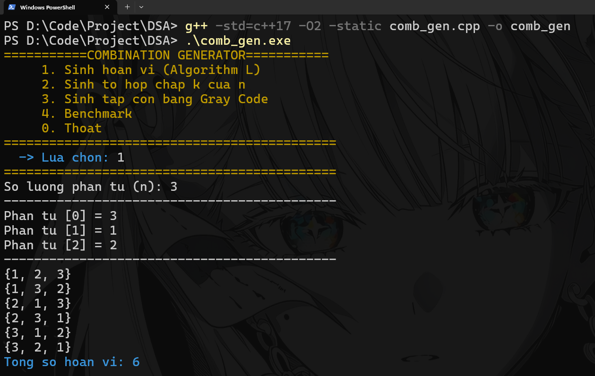

**Tổ hợp n = 5, k = 3:** Giá trị tối đa của vị trí i (đánh số từ 0) là n - k + i + 1, tức 3, 4, 5. Mỗi bước: tìm vị trí i phải nhất chưa đạt tối đa, tăng a[i] lên 1, rồi đặt các phần tử sau i tăng dần liên tiếp.

| Bước | Tổ hợp hiện tại | Vị trí i | Tổ hợp kế tiếp |
|---|---|---|---|
| 1 | {1, 2, 3} | 2 | {1, 2, 4} |
| 2 | {1, 2, 4} | 2 | {1, 2, 5} |
| 3 | {1, 2, 5} | 1 (a[2] = 5 đã tối đa) | {1, 3, 4} |
| 4 | {1, 3, 4} | 2 | {1, 3, 5} |
| 5 | {1, 3, 5} | 1 | {1, 4, 5} |
| 6 | {1, 4, 5} | 0 (a[1] = 4, a[2] = 5 đã tối đa) | {2, 3, 4} |
| 7 | {2, 3, 4} | 2 | {2, 3, 5} |
| 8 | {2, 3, 5} | 1 | {2, 4, 5} |
| 9 | {2, 4, 5} | 0 | {3, 4, 5} |
| 10 | {3, 4, 5} | không có | Dừng, trả về `false` |

Output chương trình in đúng 10 tổ hợp theo thứ tự trên và `Tong so to hop: 10`, bằng C(5, 3) = 10.

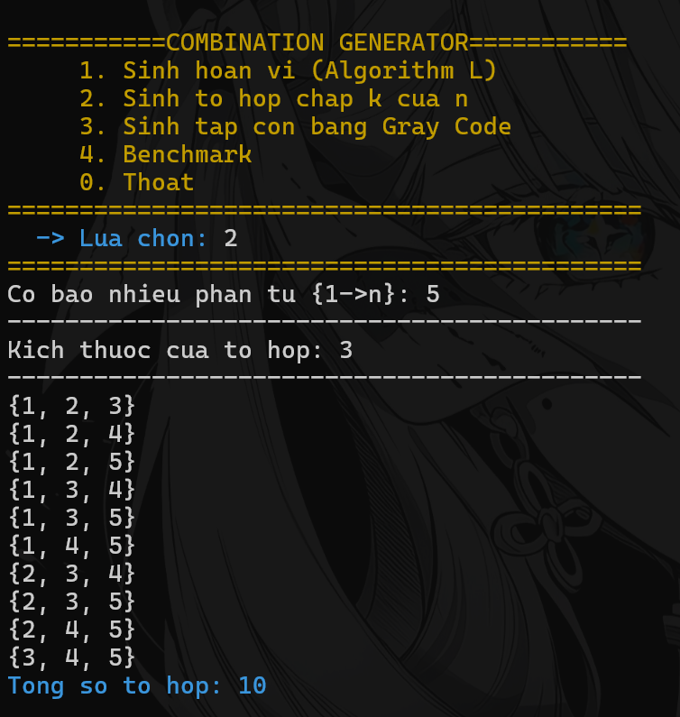

### 3.2. Các trường hợp kiểm thử

**Sinh hoán vị (menu 1):**

| Mã | Trường hợp | Đầu vào | Kết quả kỳ vọng | Kết quả thực tế | Trạng thái |
|---|---|---|---|---|---|
| TC10 | Cơ bản (đối chiếu trace tay) | n = 3, {3, 1, 2} | 3! = 6 hoán vị theo thứ tự từ điển | 6 hoán vị khớp bảng trace ở mục 3.1, `Tong so hoan vi: 6` | PASS |
| TC11 | Biên n = 0 | n = 0 | 1 hoán vị rỗng | In `{}`, `Tong so hoan vi: 1` | PASS |
| TC12 | Một phần tử | n = 1, {7} | 1 hoán vị | In `{7}`, `Tong so hoan vi: 1` | PASS |
| TC13 | Có phần tử trùng | n = 3, {1, 1, 2} | 3!/2! = 3 hoán vị, không lặp lại | `{1, 1, 2}`, `{1, 2, 1}`, `{2, 1, 1}`, `Tong so hoan vi: 3` | PASS |
| TC14 | Tất cả phần tử trùng | n = 3, {2, 2, 2} | 1 hoán vị | In `{2, 2, 2}`, `Tong so hoan vi: 1` | PASS |
| TC15 | Kích thước lớn nhất cho phép | n = 10, {1, ..., 10} | 10! = 3 628 800 hoán vị, kết thúc ở dãy giảm dần | Dòng cuối `{10, 9, 8, 7, 6, 5, 4, 3, 2, 1}`, `Tong so hoan vi: 3628800` | PASS |
| TC16 | Dữ liệu không hợp lệ (âm) | n = -1 | Báo lỗi và quay lại menu | `Loi: n phai thoa 0 <= n <= 10` | PASS |
| TC17 | Vượt giới hạn | n = 11 | Báo lỗi và quay lại menu | `Loi: n phai thoa 0 <= n <= 10` | PASS |

Ở TC13 và TC14, chương trình không in hoán vị nào bị lặp lại là nhờ dấu `>=` ở dòng 10 và `<=` ở dòng 14. Pivot chỉ được đổi với một phần tử lớn hơn nó, rồi phần đuôi được đảo để tạo hoán vị kế tiếp theo thứ tự từ điển. Vì mỗi bước đều tăng thứ tự từ điển, chương trình không sinh lại hoán vị đã xuất hiện.

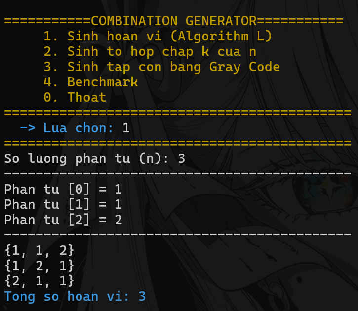

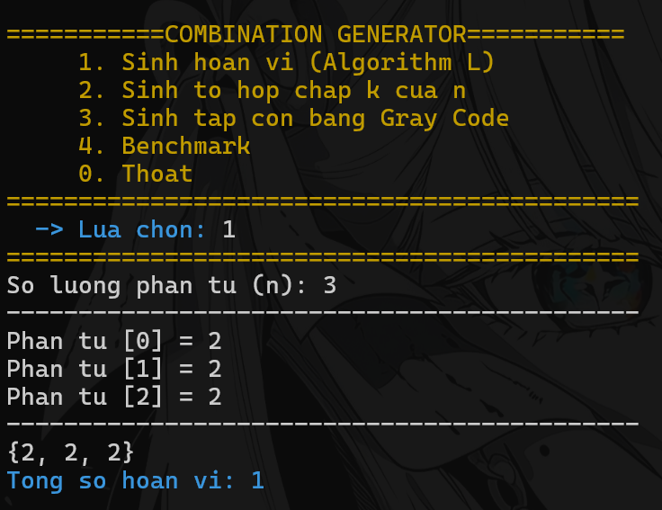

**Sinh tổ hợp (menu 2):**

| Mã | Trường hợp | Đầu vào | Kết quả kỳ vọng | Kết quả thực tế | Trạng thái |
|---|---|---|---|---|---|
| TC18 | Cơ bản (đối chiếu trace tay) | n = 5, k = 3 | C(5, 3) = 10 tổ hợp theo thứ tự từ điển | 10 tổ hợp khớp bảng trace ở mục 3.1, `Tong so to hop: 10` | PASS |
| TC19 | Biên k = 0 | n = 4, k = 0 | 1 tổ hợp rỗng | In `{}`, `Tong so to hop: 1` | PASS |
| TC20 | Biên k = n | n = 4, k = 4 | 1 tổ hợp gồm tất cả phần tử | In `{1, 2, 3, 4}`, `Tong so to hop: 1` | PASS |
| TC21 | Kích thước lớn nhất cho phép | n = 20, k = 10 | C(20, 10) = 184 756 tổ hợp | `Tong so to hop: 184756` | PASS |
| TC22 | k lớn hơn n | n = 3, k = 5 | Báo lỗi và quay lại menu | `Loi: can 0 <= k <= n <= 20` | PASS |
| TC23 | Vượt giới hạn | n = 21, k = 3 | Báo lỗi và quay lại menu | `Loi: can 0 <= k <= n <= 20` | PASS |

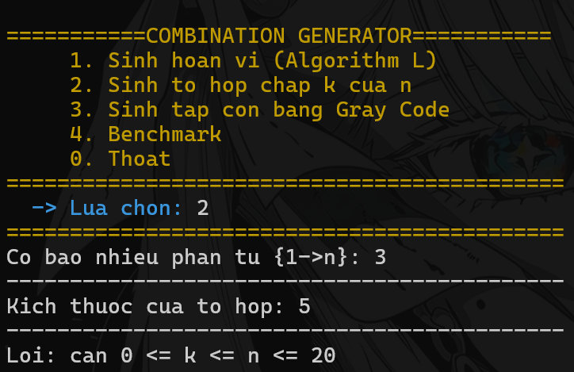

**Menu chính:**

| Mã | Trường hợp | Đầu vào | Kết quả kỳ vọng | Kết quả thực tế | Trạng thái |
|---|---|---|---|---|---|
| TC24 | Nhập chữ thay vì số | `abc` | Thoát chương trình, không treo | Chương trình kết thúc | PASS |

### 3.3. Kiểm chứng số lượng cấu hình với dữ liệu lớn

Benchmark đếm đúng số cấu hình ở mọi bộ dữ liệu, lớn nhất là 12!, C(30, 15) và 2²⁸. Cùng với TC15, TC21 và các test Gray Code tuần 2, cả ba thuật toán đã được kiểm tra số lượng với n từ 10 trở lên, đúng yêu cầu 4 của đề.

## 4. Tích hợp và quản lý mã nguồn

Công việc tuần 3 được thực hiện trên nhánh `week3` và tích hợp vào `main` qua PR #9, #10. Các chỉnh sửa sau khi review (viết lại benchmark, sửa lời nhắc menu) được thực hiện trên nhánh `review/week3` và tích hợp vào `main` qua PR #11.

**Mã nguồn:**
- Hàm `main` với menu tô màu ANSI và kiểm tra đầu vào: https://github.com/QuangquyNguyenvo/DSA_final_project/blob/faf925f/comb_gen.cpp#L90-L165
- Sinh hoán vị (`nextPermutation`): https://github.com/QuangquyNguyenvo/DSA_final_project/blob/faf925f/comb_gen.cpp#L8-L19
- Sinh tổ hợp (`nextCombination`): https://github.com/QuangquyNguyenvo/DSA_final_project/blob/faf925f/comb_gen.cpp#L20-L28
- Sinh Gray Code (`graycode`) và hàm kiểm tra (`verifyGray`): https://github.com/QuangquyNguyenvo/DSA_final_project/blob/faf925f/comb_gen.cpp#L43-L80
- File benchmark: https://github.com/QuangquyNguyenvo/DSA_final_project/blob/c703bcb/benchmark.h
- Kết quả benchmark: https://github.com/QuangquyNguyenvo/DSA_final_project/blob/dbce015/bench_results.csv

**Pull Request:**
- PR #9 (`week3`, Đào Nghiệm Minh): hoàn thiện giao diện CLI, thêm báo cáo tuần 3 và phần phân tích độ phức tạp: https://github.com/QuangquyNguyenvo/DSA_final_project/pull/9
- PR #10 (`week3`, Đào Nghiệm Minh): bổ sung phần tổng quan, thiết kế CLI và benchmark: https://github.com/QuangquyNguyenvo/DSA_final_project/pull/10
- PR #11 (`review/week3`, Nguyễn Võ Quang Quý): viết lại benchmark, sửa phép đo Gray Code, bổ sung kiểm thử và hoàn thiện báo cáo tuần 3: https://github.com/QuangquyNguyenvo/DSA_final_project/pull/11

**Commit:**
- [`ae634c2`](https://github.com/QuangquyNguyenvo/DSA_final_project/commit/ae634c2): tô màu menu và kết quả bằng mã ANSI, thêm khung viền và đổi lời nhắc nhập dữ liệu cho rõ ràng (Minh).
- [`3e8d482`](https://github.com/QuangquyNguyenvo/DSA_final_project/commit/3e8d482): thêm báo cáo tuần 3 và phân tích độ phức tạp (Minh).
- [`6ddda19`](https://github.com/QuangquyNguyenvo/DSA_final_project/commit/6ddda19): merge PR #9, tích hợp tuần 3 vào `main`.
- [`d8f1ace`](https://github.com/QuangquyNguyenvo/DSA_final_project/commit/d8f1ace): bổ sung phần tổng quan, thiết kế CLI và kế hoạch tuần 4 (Minh).
- [`edbfebe`](https://github.com/QuangquyNguyenvo/DSA_final_project/commit/edbfebe): thêm benchmark so sánh thời gian chạy với công thức vào menu CLI (Minh).
- [`964e0e1`](https://github.com/QuangquyNguyenvo/DSA_final_project/commit/964e0e1): merge PR #10.
- [`1a2a6f6`](https://github.com/QuangquyNguyenvo/DSA_final_project/commit/1a2a6f6): viết lại benchmark gọn hơn, sửa phép đo Gray Code bị trình biên dịch tối ưu mất (Quý).
- [`c703bcb`](https://github.com/QuangquyNguyenvo/DSA_final_project/commit/c703bcb): rút gọn comment nguồn mã màu ANSI (Quý).
- [`faf925f`](https://github.com/QuangquyNguyenvo/DSA_final_project/commit/faf925f): in lời nhắc lựa chọn sau đường viền menu (Quý).
- [`dbce015`](https://github.com/QuangquyNguyenvo/DSA_final_project/commit/dbce015): hoàn thiện báo cáo tuần 3, đo lại benchmark Gray Code (Quý).

## 5. Phân công công việc

| Thành viên | MSSV | Công việc tuần 3 |
|---|---|---|
| Đào Nghiệm Minh | 25110042 | - Hoàn thiện giao diện CLI (tô màu, khung viền, lời nhắc nhập dữ liệu).<br>- Phân tích độ phức tạp của ba thuật toán.<br>- Xây dựng benchmark phiên bản đầu và đo Bảng 1, Bảng 2.<br>- Viết phần tổng quan, thiết kế CLI, độ phức tạp và benchmark trong báo cáo. |
| Nguyễn Võ Quang Quý | 25110055 | - Review mã nguồn benchmark, phát hiện lỗi phép đo Gray Code.<br>- Viết lại `benchmark.h` và đo lại Bảng 3.<br>- Kiểm thử và trace tay sinh hoán vị, sinh tổ hợp.<br>- Viết phần kiểm thử, tích hợp mã nguồn, khó khăn và bổ sung kế hoạch tuần 4. |
| Cả nhóm | | - Kiểm tra chéo mã nguồn và báo cáo.<br>- Nộp bài. |

## 6. Khó khăn và hướng giải quyết

- **Phép đo Gray Code bản đầu không đáng tin:** bản benchmark đầu gọi `verifyGray()` nhưng không dùng kết quả trả về. Trên máy 1 (g++ 12), phép đo ra khoảng 3,2 ns mỗi mã, nhưng con số này tính cả thời gian kiểm tra chứ không chỉ thời gian sinh mã. Trên máy 2 (g++ 16), trình biên dịch bỏ luôn vòng lặp khi tối ưu `-O2` nên phép đo ra 0 ms. Nhóm sửa bằng cách bỏ `verifyGray()` khỏi phép đo và XOR các mã Gray vào biến `grayXor` để vòng lặp không bị bỏ. Bản mới đo được khoảng 0,45 ns mỗi mã.
- **Chương trình bị crash trên máy 2:** máy lấy nhầm file `libstdc++-6.dll` cũ đi kèm Git. Biên dịch thêm cờ `-static` thì chương trình chạy bình thường.
- **Lời nhắc chọn menu nằm sai chỗ:** khi chạy thử để chụp ảnh minh chứng, nhóm thấy `-> Lua chon:` được in trước đường viền `====`, khiến người dùng phải gõ lựa chọn ở dòng bên dưới đường viền. Nhóm đổi lại thứ tự in để con trỏ đứng ngay sau `-> Lua chon:`.
- **Chưa làm phần giới hạn số cấu hình được in:** tuần này nhóm dồn thời gian sửa benchmark nên chưa kịp, phần này chuyển sang tuần 4.

## 7. Kế hoạch tuần 4

- Bổ sung tùy chọn chỉ in k cấu hình đầu tiên cho cả ba menu, đúng yêu cầu CLI của đề bài và kế hoạch từ tuần 2.
- Chạy lại toàn bộ benchmark trên máy 1 với `benchmark.h` mới, cập nhật `bench_results.csv` và ba bảng kết quả.
- Vẽ biểu đồ thời gian và ns/cấu hình từ `bench_results.csv`.
- Hoàn thiện báo cáo kỹ thuật và Self-Explanation cho từng yêu cầu của đề bài.
- Chuẩn bị cho phần vấn đáp đề tài.

## 8. Khai báo sử dụng AI và nguồn tài liệu tham khảo

### 8.1. Khai báo sử dụng AI và nguồn gốc kiến thức

Trong tuần 3, nhóm chủ yếu tự nghiên cứu tài liệu, hoàn thiện mã nguồn, chạy kiểm thử và thực hiện benchmark. Phần lớn kiến thức được nhóm tự tìm hiểu từ các nguồn tìm được qua công cụ tìm kiếm Google, được liệt kê ở mục 8.2.

Sau khi hoàn thành cài đặt, kiểm thử và benchmark, nhóm sử dụng `Gemini 3.8 Flash` để rà soát một số kiến thức kỹ thuật về #pragma once, inline, độ phức tạp của Gray Code và phương pháp đánh giá benchmark. AI được sử dụng để giải thích, đối chiếu và điều chỉnh một số nhận định kỹ thuật, không tham gia viết mã nguồn hay thay thế quá trình kiểm chứng của nhóm.

**Minh chứng:** [Cuộc trò chuyện với Gemini](https://share.gemini.google/RBkOQo69pslz).

### 8.2. Tài liệu tham khảo

**[1] Stack Overflow: List of ANSI color escape sequences**

[https://stackoverflow.com/questions/4842424/list-of-ansi-color-escape-sequences](https://stackoverflow.com/questions/4842424/list-of-ansi-color-escape-sequences)

Nội dung liên quan: Danh sách mã ANSI escape dùng để tô màu chữ trên terminal.

**[2] cppreference: std::chrono::steady_clock**

[https://en.cppreference.com/w/cpp/chrono/steady_clock](https://en.cppreference.com/w/cpp/chrono/steady_clock)

Nội dung liên quan: Đồng hồ đo thời gian không bị ảnh hưởng khi chỉnh giờ hệ thống, dùng để đo thời gian chạy trong benchmark.

**[3] VNOI Wiki: Độ phức tạp thời gian**

[https://wiki.vnoi.info/algo/basic/computational-complexity](https://wiki.vnoi.info/algo/basic/computational-complexity)

Nội dung liên quan: Cách đánh giá độ phức tạp thời gian của thuật toán và ký hiệu Big-O.

**[4] Viblo: Cấu trúc dữ liệu và Giải thuật Bài 3: Độ phức tạp thời gian (Time Complexity) và Ký pháp Big-O**

[https://viblo.asia/p/cau-truc-du-lieu-va-giai-thuat-bai-3-do-phuc-tap-thoi-gian-time-complexity-va-ky-phap-big-o-1QLxnmjO4Aw](https://viblo.asia/p/cau-truc-du-lieu-va-giai-thuat-bai-3-do-phuc-tap-thoi-gian-time-complexity-va-ky-phap-big-o-1QLxnmjO4Aw)

Nội dung liên quan: Đánh giá thuật toán theo tốc độ tăng của số phép toán thay vì thời gian đo bằng giây, các cấp độ phức tạp thường gặp.

**[5] Viblo: Cấu trúc dữ liệu và Giải thuật Bài 8: Giới thiệu về Amortized Analysis (Phân tích khấu hao)**

[https://viblo.asia/p/cau-truc-du-lieu-va-giai-thuat-bai-8-gioi-thieu-ve-amortized-analysis-phan-tich-khau-hao-pPLkNbleJRZ](https://viblo.asia/p/cau-truc-du-lieu-va-giai-thuat-bai-8-gioi-thieu-ve-amortized-analysis-phan-tich-khau-hao-pPLkNbleJRZ)

Nội dung liên quan: Phân tích khấu hao, tính chi phí trung bình của một thao tác trong một chuỗi thao tác liên tiếp.

**[6] GeeksforGeeks: Measure execution time of a function in C++**

[https://www.geeksforgeeks.org/cpp/measure-execution-time-function-cpp/](https://www.geeksforgeeks.org/cpp/measure-execution-time-function-cpp/)

Nội dung liên quan: Đo thời gian chạy của một hàm bằng thư viện `<chrono>`, lấy thời điểm trước và sau khi chạy rồi tính hiệu.

**[7] USACO Guide: Time Complexity**

[https://usaco.guide/bronze/time-comp](https://usaco.guide/bronze/time-comp)

Nội dung liên quan: Ký hiệu Big-O, độ phức tạp của các vòng lặp, độ phức tạp O(2ⁿ) khi duyệt mọi tập con và O(n!) khi duyệt mọi hoán vị.

---
# BÁO CÁO TIẾN ĐỘ (Tuần 4): Bổ sung và tối ưu chương trình

**Môn học:** Cấu trúc dữ liệu và Giải thuật.

**Mã lớp học phần:** DASA230179_Dot1, HK1 2026-2027.

**Giảng viên hướng dẫn:** Huỳnh Xuân Phụng.

**GitHub Repository:** https://github.com/QuangquyNguyenvo/DSA_final_project

## 1. Tổng quan

Sau tuần 3, chương trình đã có đủ ba thuật toán, menu và benchmark. Tuần 4 nhóm không thêm thuật toán mới mà tập trung bổ sung phần còn thiếu và hoàn thiện chương trình:

- Thêm tùy chọn chỉ in một số cấu hình đầu tiên cho cả ba menu (phần còn nợ từ tuần 3).
- Đo lại benchmark của cả ba thuật toán trên cùng một máy, rồi vẽ biểu đồ từ kết quả đo.
- Dọn mã nguồn: bỏ hàm cũ không còn dùng và tăng tốc phần in kết quả.
- Kiểm thử phần mới và chạy lại các test cũ sau khi sửa.
- Tổng kết lại các yêu cầu của đề bài (mục 8).
- Viết hướng dẫn biên dịch và chạy chương trình (mục 7).

**Minh chứng:**
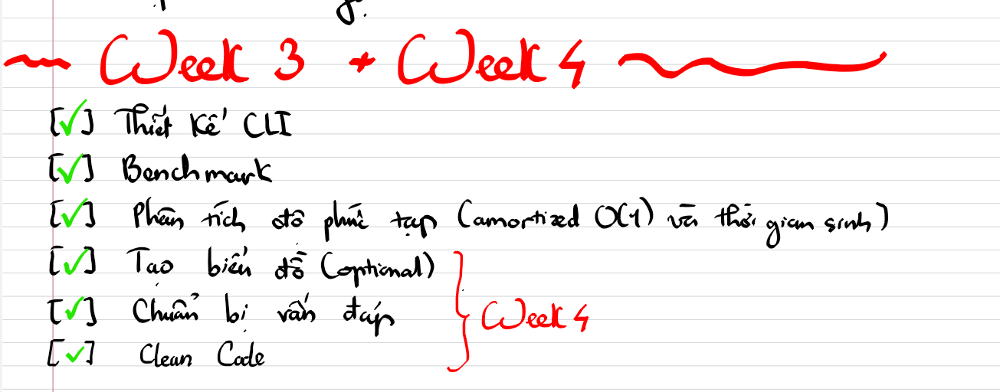

## 2. Công việc thực hiện

### 2.1. Giới hạn số cấu hình được in

Tuần 3 chỉ chặn n để tránh in quá nhiều dòng, nhưng ở giới hạn trên chương trình vẫn in rất nhiều (hoán vị n = 10 ra khoảng 3,6 triệu dòng, Gray Code n = 30 ra hơn 1 tỉ dòng). Tuần này nhóm cho người dùng chọn số cấu hình muốn in ở cả ba menu, theo đúng yêu cầu CLI của đề bài.

**Cách hoạt động:**

- Nhập xong thông số, chương trình hỏi thêm `So cau hinh muon in (0 = tat ca):`.
- Chương trình in tối đa `limit` cấu hình đầu tiên, nếu vẫn còn cấu hình chưa in thì in thêm `...`. Nhập `0` thì in hết như trước.
- Thuật toán vẫn sinh đủ mọi cấu hình, nên `Tong so ...` vẫn là tổng thật và `verifyGray()` vẫn kiểm tra đủ 2ⁿ mã.
- Vì vậy giới hạn in chỉ làm output ngắn lại, thời gian chạy vẫn tăng theo tổng số cấu hình.
- Trong code, giá trị này tên là `limit` để không nhầm với k trong "tổ hợp chập k".

| Lựa chọn | Dữ liệu nhập (theo thứ tự) | Điều kiện của `limit` |
|---|---|---|
| 1. Hoán vị | n, n phần tử, `limit` | `limit` ≥ 0 |
| 2. Tổ hợp | n, k, `limit` | `limit` ≥ 0 |
| 3. Gray Code | n, `limit` | `limit` ≥ 0 |

Giới hạn n của từng menu vẫn giữ như tuần 3.

**Thay đổi trong mã nguồn:**

- Thêm hàm `readLimit()` để đọc `limit`. Nhập số âm hoặc nhập chữ thì báo lỗi và quay lại menu (xem mục 6).
- Hoán vị và tổ hợp: vòng `do ... while` vẫn chạy hết, chỉ gọi `print(a)` khi `limit == 0` hoặc `cnt < limit`.
- Gray Code: hàm `graycode()` tự in mã trong vòng lặp nên được thêm tham số `limit`. `benchmark.h` không gọi hàm này nên không phải sửa.

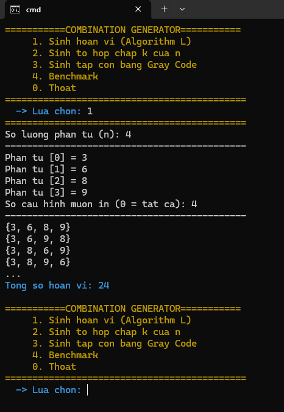

**Điều chỉnh giao diện:**

- Lời nhắc ban đầu dài 51 ký tự, tràn ra ngoài đường viền `----` (44 ký tự), nên được rút gọn còn `So cau hinh muon in (0 = tat ca): ` (34 ký tự).
- Các thông báo lỗi `Loi: ...` được tô đỏ (`\033[31m`), giống dòng `Kiem tra Gray Code: SAI`.

**Mã nguồn:**
- Hàm `readLimit`: https://github.com/QuangquyNguyenvo/DSA_final_project/blob/997cfa2/comb_gen.cpp#L82-L93
- Hàm `graycode` có tham số `limit`: https://github.com/QuangquyNguyenvo/DSA_final_project/blob/997cfa2/comb_gen.cpp#L48-L72
- Hàm `main`: https://github.com/QuangquyNguyenvo/DSA_final_project/blob/997cfa2/comb_gen.cpp#L95-L181

### 2.2. Đo lại benchmark trên máy 1

Ở tuần 3, Bảng 1 và Bảng 2 đo trên máy 1 bằng bản benchmark đầu (`edbfebe`), còn Bảng 3 đo trên máy 2 bằng bản viết lại (`1a2a6f6`), nên ba bảng không so trực tiếp được. Tuần này nhóm đo lại cả ba thuật toán trong cùng một lần chạy, trên máy 1 với `benchmark.h` mới.

**Môi trường đo:** máy 1, giống mục 2.3.2 tuần 3.

| Thành phần | Máy 1 |
|---|---|
| CPU | Intel Core i7-11800H (11th Gen), 8 nhân / 16 luồng, 2.30 GHz |
| RAM | 8 GB |
| Trình biên dịch | g++ 12.1.0 (MinGW-W64 x86_64, posix-seh) |
| Cờ biên dịch | `g++ -std=c++17 -O2 comb_gen.cpp -o comb_gen` |
| Bản benchmark | `benchmark.h` bản viết lại ([`1a2a6f6`](https://github.com/QuangquyNguyenvo/DSA_final_project/blob/1a2a6f6/benchmark.h)) |

Cách đo và bộ dữ liệu giống mục 2.3.3 và 2.3.4 tuần 3 (1 lần khởi động, 5 lần đo, lấy median). Benchmark không in cấu hình nên phần giới hạn in không ảnh hưởng tới kết quả.

**Điều kiện chạy:** ở lần chạy đầu, số liệu Gray Code dao động từ 0,48 đến 0,62 ns mỗi mã (lý do ở mục 6). Nhóm chạy lại 3 lần, cả ba lần đều ra 0,46 đến 0,50 ns. Các bảng dưới đây lấy số liệu của lần đầu tiên trong 3 lần này.

**Bảng 4. Hoán vị (Algorithm L), máy 1**

| n | Số cấu hình (n!) | total_ms (median) | ns/cấu hình | Tỉ lệ thời gian | Tỉ lệ công thức |
|---|---|---|---|---|---|
| 8 | 40 320 | 0,1249 | 3,10 |  |  |
| 9 | 362 880 | 1,093 | 3,01 | 8,75 | 9 |
| 10 | 3 628 800 | 10,22 | 2,82 | 9,35 | 10 |
| 11 | 39 916 800 | 113,1 | 2,83 | 11,07 | 11 |
| 12 | 479 001 600 | 1 375 | 2,87 | 12,16 | 12 |

**Bảng 5. Tổ hợp chập k của n (k = n/2), máy 1**

| n | k | Số cấu hình C(n, k) | total_ms (median) | ns/cấu hình | Tỉ lệ thời gian | Tỉ lệ công thức |
|---|---|---|---|---|---|---|
| 16 | 8 | 12 870 | 0,0332 | 2,58 |  |  |
| 18 | 9 | 48 620 | 0,125 | 2,57 | 3,77 | 3,78 |
| 20 | 10 | 184 756 | 0,476 | 2,58 | 3,81 | 3,80 |
| 22 | 11 | 705 432 | 1,821 | 2,58 | 3,83 | 3,82 |
| 24 | 12 | 2 704 156 | 7,292 | 2,70 | 4,00 | 3,83 |
| 26 | 13 | 10 400 600 | 28,37 | 2,73 | 3,89 | 3,85 |
| 28 | 14 | 40 116 600 | 104,7 | 2,61 | 3,69 | 3,86 |
| 30 | 15 | 155 117 520 | 414,1 | 2,67 | 3,95 | 3,87 |

**Bảng 6. Gray Code (chỉ sinh mã, không kiểm tra), máy 1**

| n | Số cấu hình (2ⁿ) | total_ms (median) | ns/cấu hình | Tỉ lệ thời gian | Tỉ lệ công thức |
|---|---|---|---|---|---|
| 16 | 65 536 | 0,0309 | 0,47 |  |  |
| 18 | 262 144 | 0,1207 | 0,46 | 3,91 | 4 |
| 20 | 1 048 576 | 0,4852 | 0,46 | 4,02 | 4 |
| 22 | 4 194 304 | 1,934 | 0,46 | 3,98 | 4 |
| 24 | 16 777 216 | 7,75 | 0,46 | 4,01 | 4 |
| 26 | 67 108 864 | 32,49 | 0,48 | 4,19 | 4 |
| 28 | 268 435 456 | 128 | 0,48 | 3,94 | 4 |

Toàn bộ kết quả được lưu trong file [`bench_results.csv`](https://github.com/QuangquyNguyenvo/DSA_final_project/blob/07548d7/bench_results.csv). Ở bản hiện tại, file này và `bench_ns_per_item.csv` đã được chuyển vào thư mục [`results/`](results/).

**Nhận xét:**

1. **Kết quả khớp với tuần 3:** hoán vị khoảng 2,8 đến 3,1 ns mỗi cấu hình, tổ hợp 2,6 đến 2,7 ns, Gray Code 0,46 đến 0,48 ns, gần như trùng với Bảng 1, 2, 3.
2. **Thời gian tăng đúng theo công thức:** cột tỉ lệ thời gian luôn gần cột tỉ lệ công thức, ví dụ hoán vị từ n = 11 lên 12 chậm đi 12,16 lần (công thức là 12).
3. **Mỗi mã Gray nhanh hơn khoảng 6 lần:** trong benchmark, mỗi mã Gray mất khoảng 0,47 ns, còn mỗi hoán vị hoặc tổ hợp mất 2,6 đến 3,1 ns. Benchmark Gray Code không gọi `verifyGray()` nên con số này không phản ánh trực tiếp tốc độ của menu 3.

### 2.3. Biểu đồ kết quả

Các biểu đồ được vẽ bằng Google Sheets từ file [`bench_results.csv`](https://github.com/QuangquyNguyenvo/DSA_final_project/blob/07548d7/bench_results.csv) ở mục 2.2:

- **Biểu đồ 1, 2, 3:** tổng thời gian sinh (`median_ms`) theo n, mỗi thuật toán một hình. Trục dọc dùng thang log vì thời gian tăng rất nhanh (hoán vị từ 0,12 ms lên 1 375 ms chỉ sau 4 lần tăng n).
- **Biểu đồ 4:** thời gian sinh một cấu hình (`ns_per_item`) của cả ba thuật toán trên cùng một hình, dữ liệu lấy từ [`bench_ns_per_item.csv`](https://github.com/QuangquyNguyenvo/DSA_final_project/blob/07548d7/bench_ns_per_item.csv) (chỉ xếp lại cột `ns_per_item` cho dễ vẽ).

**Biểu đồ 1, 2, 3. Thời gian sinh theo n của hoán vị (Algorithm L), tổ hợp chập k của n (k = n/2) và Gray Code**

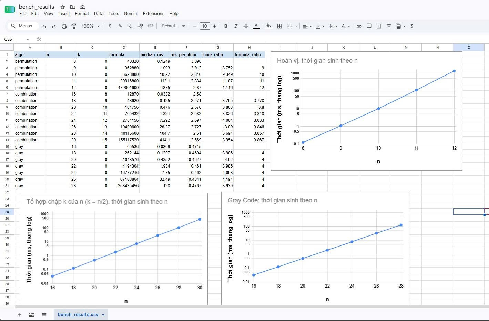

**Biểu đồ 4. Thời gian sinh một cấu hình theo n**

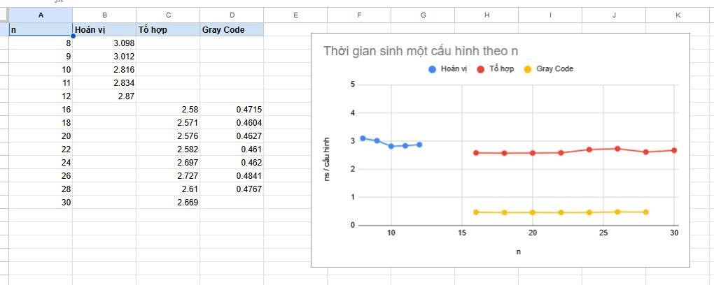

**Nhận xét:**

1. **Biểu đồ 1, 2, 3 gần như thẳng trên thang log:** thời gian tăng đúng theo số cấu hình. Gray Code tăng theo 2ⁿ, tổ hợp với k = n/2 tăng chậm hơn 2ⁿ một chút. Riêng đường hoán vị hơi cong lên, vì mỗi lần n tăng 1 thì số hoán vị nhân thêm n + 1, hệ số này lớn dần.
2. **Biểu đồ 4 gần như nằm ngang:** thời gian sinh một cấu hình gần như không đổi khi n tăng, đúng với O(1) khấu hao (mục 2.2 tuần 3).
3. **Biểu đồ 2 và 3 giống nhau chỉ là trùng hợp:** Gray Code nhiều cấu hình hơn khoảng 5 đến 7 lần nhưng mỗi cấu hình nhanh hơn khoảng 5,5 lần, nên tổng thời gian xấp xỉ nhau.

### 2.4. In tập con (subset) bên cạnh mã Gray

Đề bài yêu cầu sinh tập con (subset generation) bằng Gray Code, trong đó hai tập con liên tiếp khác nhau đúng một phần tử. Trước đây, chương trình chỉ in chuỗi bit như `{ 1 1 0 }`. Chuỗi bit đã biểu diễn một tập con, nhưng chưa hiển thị trực tiếp các phần tử được chọn.

Nhóm bổ sung phần in tập con thật của tập {1, 2, ..., n} ngay bên cạnh chuỗi bit. Các bit từ trái sang phải lần lượt ứng với phần tử 1 đến n, bit bằng 1 nghĩa là phần tử đó thuộc tập con. 

Ví dụ với n = 3:

Với `n = 3`, xét tập `S = {1, 2, 3}`. Ở mỗi bước, tính `G(i) = i ^ (i >> 1)`, viết mã thành 3 bit rồi chọn các phần tử ứng với bit `1`. Trong bảng, dấu ✓ nghĩa là chọn, dấu × nghĩa là không chọn. Ví dụ, `i = 2` cho `G(2) = 011`, tương ứng tập con `{2, 3}`. Bước tiếp theo là `010`, tương ứng `{2}`: chỉ bỏ phần tử `3`. Mã `000` biểu diễn tập rỗng `{}`.

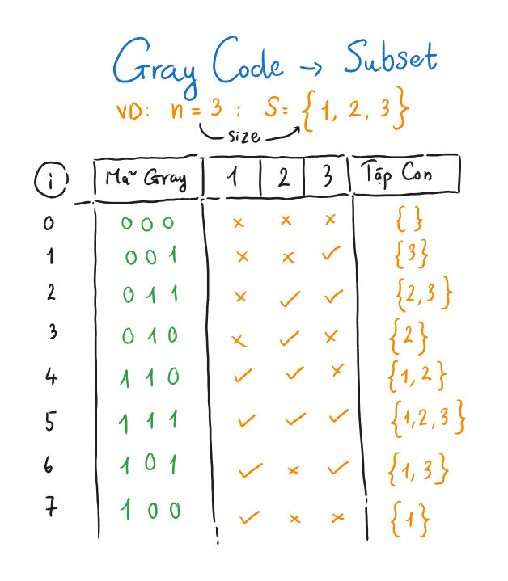

Thay đổi chỉ nằm ở phần in trong `graycode()`. Trong code, `j` là chỉ số bit tính từ phải, bắt đầu từ `0`. Vòng lặp duyệt `j` từ `n-1` xuống `0`, tức duyệt các bit từ trái sang phải; nếu bit bằng `1` thì in phần tử tương ứng là `n-j`. Biến `first` dùng để ngăn cách các phần tử bằng dấu phẩy. Công thức `i ^ (i >> 1)`, thứ tự mã Gray, giới hạn in và phần kiểm tra `verifyGray()` vẫn giữ nguyên.

Cách hiển thị này làm rõ kết quả subset theo yêu cầu đề bài: người dùng vừa thấy mã bit, vừa thấy tập con tương ứng, và có thể đối chiếu trực tiếp việc mỗi bước chỉ thêm hoặc bỏ đúng một phần tử. Chương trình đã được biên dịch và chạy thử với n = 3 và n = 0 (tập rỗng), phần kiểm tra Gray Code đều trả về đúng.

**Minh chứng sau khi sửa:**

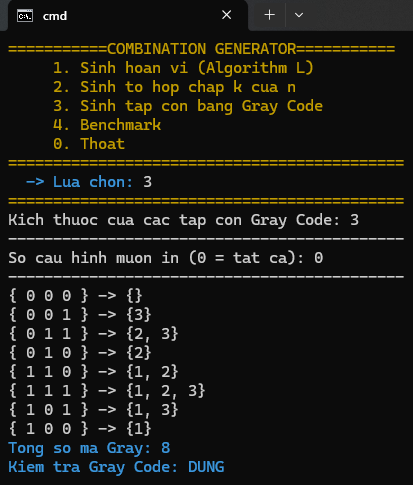

### 2.5. Dọn mã nguồn và tăng tốc in kết quả

Nhóm đọc lại `comb_gen.cpp` và sửa thêm vài chỗ nhỏ:

- **Bỏ hàm `legacyNextGray`:** hàm sinh Gray Code cũ, đã không còn được gọi từ khi nhóm chuyển sang công thức `i ^ (i >> 1)`.
- **Tăng tốc phần in:** thêm `ios::sync_with_stdio(false);` ở đầu `main`. Lệnh này tắt đồng bộ giữa `cin`/`cout` với `printf`/`scanf` của C. Chương trình chỉ dùng `cin`/`cout` nên không bị ảnh hưởng gì.
- **Sửa chính tả:** `Greycode` thành `Gray Code` ở lời nhắc menu 3.

**Đo thời gian in:** nhóm cho cả hai bản in hết 10! hoán vị và 2²² mã Gray (khoảng 7,8 triệu dòng) ra file, mỗi bản chạy 2 lần trên máy 2 (g++ 16.2.0, `-O2 -static`).

| Bản | Lần 1 | Lần 2 |
|---|---|---|
| Trước khi sửa (`5d553d1`) | 11,98 s | 11,54 s |
| Sau khi sửa (`997cfa2`) | 5,71 s | 5,90 s |

Thời gian in giảm còn khoảng một nửa, còn output của hai bản giống hệt nhau (kiểm tra bằng lệnh `cmp`). Mỗi bản chỉ chạy 2 lần nên số liệu này dùng để minh họa, chưa đủ để kết luận cho mọi máy. Benchmark ở mục 2.2 không in nên không bị ảnh hưởng.

**Mã nguồn:** commit dọn mã nguồn: https://github.com/QuangquyNguyenvo/DSA_final_project/commit/997cfa2

## 3. Kiểm thử và kiểm chứng

### 3.1. Kiểm thử phần giới hạn số cấu hình được in

Các kết quả và ảnh trong phần này được ghi nhận trước khi bổ sung cách in subset ở mục 2.4; phiên bản hiện tại in thêm tập con bên cạnh chuỗi bit. Phép so sánh output sau khi dọn mã nguồn cũng thuộc thời điểm trước thay đổi hiển thị này.

Ở mỗi test, nhóm kiểm tra ba điều: chương trình in đúng `limit` cấu hình đầu, có `...` khi còn cấu hình chưa in, và `Tong so ...` vẫn là tổng thật. Mã test được đánh số tiếp theo tuần 3.

| Mã | Menu | Đầu vào | Kết quả kỳ vọng | Kết quả thực tế | Trạng thái |
|---|---|---|---|---|---|
| TC25 | 1. Hoán vị | n = 3, {3, 1, 2}, `limit` = 2 | In 2 hoán vị đầu, có `...`, tổng 3! = 6 | `{1, 2, 3}`, `{1, 3, 2}`, `...`, `Tong so hoan vi: 6` | PASS |
| TC26 | 1. Hoán vị | n = 3, {3, 1, 2}, `limit` = 0 | In đủ 6 hoán vị như tuần 3, không có `...` | 6 hoán vị, `Tong so hoan vi: 6` | PASS |
| TC27 | 1. Hoán vị | n = 2, {1, 2}, `limit` = 2 | `limit` bằng tổng: in đủ 2 hoán vị, không có `...` | `{1, 2}`, `{2, 1}`, `Tong so hoan vi: 2` | PASS |
| TC28 | 1. Hoán vị | n = 3, {3, 1, 2}, `limit` = 100 | `limit` lớn hơn tổng: in đủ 6 hoán vị, không có `...` | 6 hoán vị, `Tong so hoan vi: 6` | PASS |
| TC29 | 1. Hoán vị | n = 10, {1, ..., 10}, `limit` = 3 | In 3 hoán vị đầu, vẫn đếm đủ 10! | 3 hoán vị, `...`, `Tong so hoan vi: 3628800` | PASS |
| TC30 | 2. Tổ hợp | n = 5, k = 2, `limit` = 3 | In 3 tổ hợp đầu, có `...`, tổng C(5, 2) = 10 | `{1, 2}`, `{1, 3}`, `{1, 4}`, `...`, `Tong so to hop: 10` | PASS |
| TC31 | 2. Tổ hợp | n = 5, k = 0, `limit` = 4 | 1 tổ hợp rỗng, không có `...` | `{}`, `Tong so to hop: 1` | PASS |
| TC32 | 2. Tổ hợp | n = 20, k = 10, `limit` = 3 | In 3 tổ hợp đầu, vẫn đếm đủ C(20, 10) | 3 tổ hợp, `...`, `Tong so to hop: 184756` | PASS |
| TC33 | 3. Gray Code | n = 0, `limit` = 5 | 1 mã rỗng, không có `...`, kiểm tra đúng | `{ }`, `Tong so ma Gray: 1`, `Kiem tra Gray Code: DUNG` | PASS |
| TC34 | 3. Gray Code | n = 30, `limit` = 1 | In 1 mã, `verifyGray()` vẫn kiểm tra đủ 2³⁰ mã | 1 mã, `...`, `Tong so ma Gray: 1073741824`, `Kiem tra Gray Code: DUNG` | PASS |
| TC35 | 3. Gray Code | n = 3, `limit` = -1 | Báo lỗi và quay lại menu | `Loi: so cau hinh can in phai >= 0` | PASS |
| TC36 | 3. Gray Code | n = 3, `limit` = `abc` | Báo lỗi, quay lại menu và dùng tiếp được | Bản `f4c36a7`: báo lỗi rồi chương trình thoát. Bản `5d553d1`: báo lỗi, quay lại menu, chạy tiếp menu 3 bình thường | PASS (sau khi sửa) |
---
Ở TC34, Gray Code n = 30 trước đây phải in hơn 1 tỉ dòng, giờ chỉ in 1 dòng mà vẫn sinh và kiểm tra đủ 2³⁰ mã.

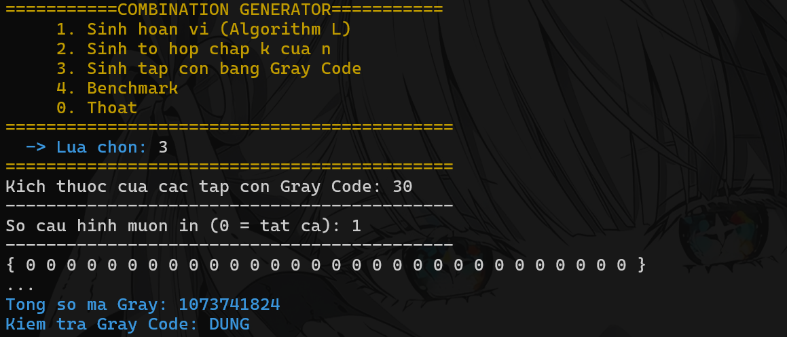
---
TC36 lúc đầu không đạt: chương trình báo lỗi đúng nhưng sau đó thoát luôn, không quay lại menu. Nguyên nhân và cách sửa ở mục 6.

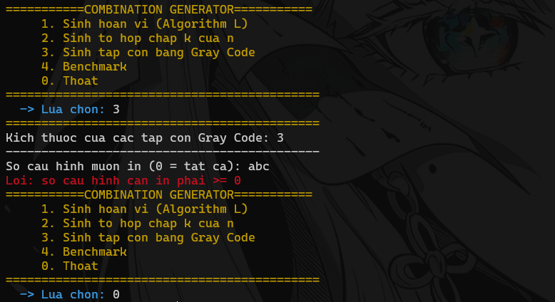
---
### 3.2. Kiểm thử lại sau khi dọn mã nguồn

Sau khi dọn mã nguồn (mục 2.5), nhóm chạy lại TC10 đến TC36 và menu 4 (benchmark). Kết quả giống hệt trước khi sửa.

## 4. Tích hợp và quản lý mã nguồn

Phần giới hạn in, đo benchmark và vẽ biểu đồ được làm trên nhánh `week4` (PR #13). Phần review, sửa lỗi, dọn mã nguồn và hoàn thiện báo cáo được làm trên nhánh `review/week4` (PR #14).

**Mã nguồn:**
- Hàm `readLimit`: https://github.com/QuangquyNguyenvo/DSA_final_project/blob/997cfa2/comb_gen.cpp#L82-L93
- Hàm `graycode` có tham số `limit`: https://github.com/QuangquyNguyenvo/DSA_final_project/blob/997cfa2/comb_gen.cpp#L48-L72
- Hàm `main` với lời nhắc `limit` ở cả ba menu: https://github.com/QuangquyNguyenvo/DSA_final_project/blob/997cfa2/comb_gen.cpp#L95-L181
- File benchmark dùng để đo Bảng 4, 5, 6: https://github.com/QuangquyNguyenvo/DSA_final_project/blob/1a2a6f6/benchmark.h
- Kết quả benchmark: https://github.com/QuangquyNguyenvo/DSA_final_project/blob/07548d7/bench_results.csv
- Dữ liệu vẽ Biểu đồ 4: https://github.com/QuangquyNguyenvo/DSA_final_project/blob/07548d7/bench_ns_per_item.csv

**Pull Request:**
- PR #13 (`week4`, Đào Nghiệm Minh): thêm giới hạn số cấu hình được in, đo lại benchmark trên máy 1 và vẽ biểu đồ: https://github.com/QuangquyNguyenvo/DSA_final_project/pull/13
- PR #14 (`review/week4`, Nguyễn Võ Quang Quý): sửa lỗi nhập chữ ở `readLimit()`, dọn mã nguồn, bổ sung kiểm thử và hoàn thiện báo cáo tuần 4: https://github.com/QuangquyNguyenvo/DSA_final_project/pull/14

**Commit:**
- [`f4c36a7`](https://github.com/QuangquyNguyenvo/DSA_final_project/commit/f4c36a7): thêm tùy chọn giới hạn số cấu hình được in cho cả ba menu, tô đỏ thông báo lỗi (Minh).
- [`07548d7`](https://github.com/QuangquyNguyenvo/DSA_final_project/commit/07548d7): thêm báo cáo tuần 4, đo lại benchmark trên máy 1 và vẽ biểu đồ (Minh).
- [`5d553d1`](https://github.com/QuangquyNguyenvo/DSA_final_project/commit/5d553d1): sửa lỗi nhập chữ ở lời nhắc số cấu hình làm chương trình thoát (Quý).
- [`997cfa2`](https://github.com/QuangquyNguyenvo/DSA_final_project/commit/997cfa2): bỏ hàm `legacyNextGray`, tăng tốc phần in, sửa chính tả lời nhắc menu 3 và viết `cin.ignore` trong `readLimit()` gọn hơn (Quý).

## 5. Phân công công việc

| Thành viên | MSSV | Công việc tuần 4 |
|---|---|---|
| Đào Nghiệm Minh | 25110042 | - Thêm hàm `readLimit()` và giới hạn số cấu hình được in cho cả ba menu.<br>- Tô đỏ các thông báo lỗi nhập liệu.<br>- Đo lại benchmark trên máy 1 (Bảng 4, 5, 6), cập nhật `bench_results.csv`.<br>- Vẽ bốn biểu đồ bằng Google Sheets.<br>- Viết mục 2.1, 2.2, 2.3 và mục 7 trong báo cáo. |
| Nguyễn Võ Quang Quý | 25110055 | - Review mã nguồn tuần 4, phát hiện và sửa lỗi nhập chữ ở `readLimit()`.<br>- Dọn mã nguồn, tăng tốc phần in và đo thời gian in trước và sau khi sửa.<br>- Kiểm thử phần giới hạn in (TC25 đến TC36) và chạy lại các test cũ.<br>- Viết mục 2.5, mục 3 đến mục 6, mục 8 và mục 9 trong báo cáo. |
| Cả nhóm | | - Kiểm tra chéo mã nguồn và báo cáo.<br>- Chuẩn bị cho phần vấn đáp.<br>- Nộp bài. |

## 6. Khó khăn và hướng giải quyết

- **Nhập chữ ở lời nhắc số cấu hình làm chương trình thoát (TC36):** khi nhập chữ thay vì số, `cin` bị lỗi và phần chữ vẫn nằm lại trong luồng nhập, nên lần đọc lựa chọn menu tiếp theo cũng lỗi và chương trình thoát. Nhóm thêm `cin.clear()` để xóa lỗi và thử `cin.ignore()` để bỏ phần chữ, nhưng chương trình vẫn thoát, vì `cin.ignore()` không có tham số chỉ bỏ 1 ký tự: nhập `abc` thì vẫn còn sót `bc`. Nhóm đổi thành `cin.ignore(1000, '\n')` để bỏ phần còn lại của dòng vừa nhập sai, tối đa 1000 ký tự. Với cách nhập bình thường thì như vậy là đủ.
- **Số liệu Gray Code dao động ở lần đo đầu:** mỗi mã chỉ mất khoảng 0,5 ns nên số liệu dễ bị ảnh hưởng bởi các ứng dụng chạy nền. Ngoài ra, laptop chạy pin có thể tự hạ xung nhịp CPU để tiết kiệm điện. Nhóm đo lại khi máy đang cắm sạc và đã tắt bớt ứng dụng, chạy 3 lần liên tiếp thì cả ba lần đều cho kết quả gần như nhau.

## 7. Hướng dẫn biên dịch và chạy chương trình

Chương trình được viết bằng C++17, sử dụng trình biên dịch G++. Hai file `comb_gen.cpp` và `benchmark.h` cần nằm cùng một thư mục.

Biên dịch:

```bash
g++ -std=c++17 -O2 comb_gen.cpp -o comb_gen
```

Nếu chương trình bị crash trên Windows do lỗi file `.dll`, thêm cờ `-static` khi biên dịch (xem tuần 3 mục 6).

Chạy trên Windows PowerShell:

```powershell
.\comb_gen.exe
```

Chạy trên Linux:

```bash
./comb_gen
```

Menu chương trình:

- **1. Sinh hoán vị (Algorithm L):** nhập n (0 ≤ n ≤ 10) và n phần tử.
- **2. Sinh tổ hợp chập k của n:** nhập n và k (0 ≤ k ≤ n ≤ 20).
- **3. Sinh tập con bằng Gray Code:** nhập n (0 ≤ n ≤ 30).
- **4. Benchmark:** đo thời gian ba thuật toán và ghi kết quả vào `results/bench_results.csv`, nên cần chạy chương trình ở thư mục gốc của repo.
- **0. Thoát.**

Ở menu 1 đến 3, sau khi nhập dữ liệu, chương trình hỏi số cấu hình muốn in (nhập 0 để in tất cả).

## 8. Tổng kết: đối chiếu yêu cầu đề bài

Tuần 4 là tuần cuối, nên nhóm tổng hợp lại từng yêu cầu của đề bài: đã làm như thế nào (Self-Explanation) và xem chi tiết ở đâu.

| Yêu cầu đề bài | Tự giải thích | Chi tiết |
|---|---|---|
| 1. Sinh hoán vị bằng Algorithm L | Tìm pivot là vị trí phải nhất có a[i] < a[i+1], đổi chỗ với phần tử phải nhất lớn hơn nó, rồi đảo đoạn phía sau để được hoán vị kế tiếp nhỏ nhất. Dãy giảm dần thì dừng. | Tuần 1 mục 2.2<br>Tuần 3 mục 3.1 |
| 2. Sinh tổ hợp chập k của n theo thứ tự từ điển | Tìm vị trí phải nhất chưa đạt giá trị tối đa n − k + i + 1, tăng nó lên 1 rồi đặt phần phía sau thành dãy tăng liên tiếp. Mọi vị trí đều đạt tối đa thì dừng. | Tuần 1 mục 2.3<br>Tuần 3 mục 3.1 |
| 3. Sinh tập con bằng Gray Code | Mã thứ i là `i ^ (i >> 1)`. Bit thứ j bằng 1 nghĩa là phần tử j có trong tập con. | Tuần 2 mục 2.3 |
| 4. Với n ≥ 10, số cấu hình khớp n!, C(n, k), 2ⁿ | Chương trình đếm mọi cấu hình đã sinh và in dòng `Tong so ...` để đối chiếu với công thức.<br>Benchmark đếm đúng tới 12!, C(30, 15) và 2²⁸. | Tuần 2 mục 3.4<br>Tuần 3 mục 3.3 |
| 5. Vì sao hai tập con Gray Code liên tiếp chỉ khác nhau đúng một phần tử | `i ^ (i+1)` là một dãy bit 1 liên tiếp ở cuối. XOR dãy đó với chính nó dịch phải 1 bit thì chỉ còn đúng một bit 1.<br>`verifyGray()` kiểm tra lại điều này bằng `__builtin_popcount(diff) == 1`. | Tuần 2 mục 3.3 |
| Độ phức tạp: thời gian sinh mỗi cấu hình và tổng thời gian | - Sinh mỗi cấu hình: hoán vị các phần tử khác nhau là O(1) khấu hao. Tổ hợp là O(k) trong trường hợp xấu nhất, O(1) khấu hao khi k ≤ n/2. Gray Code là O(1) mỗi bước.<br>- Tổng thời gian khi in: O(n · n!), O(k · C(n, k)) và O(n · 2ⁿ).<br>- Đo thực tế: khoảng 2,6 đến 3,1 ns mỗi hoán vị hoặc tổ hợp, 0,47 ns mỗi mã Gray. | Tuần 3 mục 2.2, 2.3<br>Tuần 4 mục 2.2, 2.3 |
| Test tối thiểu | - Trace tay: hoán vị n = 3, tổ hợp n = 5, k = 3 (TC10, TC18 tuần 3) và Gray Code n = 4 (tuần 2 mục 3.5).<br>- Dữ liệu lớn: 10!, C(20, 10), 2³⁰ (TC15, TC21 tuần 3; TC34 tuần 4) và benchmark.<br>- Trường hợp biên: n = 0, k = 0, k = n, phần tử trùng, nhập sai (TC01 tuần 2; TC11 đến TC14, TC19, TC20 tuần 3; TC33, TC36 tuần 4). | Mục 3 của tuần 2, 3, 4 |
| CLI in k cấu hình đầu | Sau khi nhập thông số, chương trình hỏi số cấu hình muốn in. Thuật toán vẫn sinh và đếm đủ mọi cấu hình. | Tuần 4 mục 2.1 |
| Hướng dẫn biên dịch và chạy | `g++ -std=c++17 -O2 comb_gen.cpp -o comb_gen`, thêm `-static` nếu gặp lỗi dll trên Windows. | Tuần 1 mục 2.4<br>Tuần 4 mục 7 |
| Khai báo sử dụng AI | Ghi ở mục khai báo AI của từng tuần. | Tuần 1 mục 7<br>Tuần 2, 3 mục 8<br>Tuần 4 mục 9 |

## 9. Khai báo sử dụng AI và nguồn tài liệu tham khảo

### 9.1. Khai báo sử dụng AI và nguồn gốc kiến thức

Trong tuần 4, nhóm chủ yếu tối ưu chương trình và hoàn thiện các phần còn thiếu từ những tuần trước, thay vì nghiên cứu thêm thuật toán mới. Các công việc được thực hiện dựa trên kiến thức đã tìm hiểu và mã nguồn đã xây dựng.

Nhóm sử dụng công cụ tìm kiếm để tra cứu cách dùng một số hàm và thiết lập nhập xuất trong C++, cụ thể là `cin.clear()`, `cin.ignore()` để xử lý dữ liệu nhập sai và `ios::sync_with_stdio(false)` để tăng tốc nhập xuất. Các tài liệu tham khảo được liệt kê tại mục 9.2.

### 9.2. Tài liệu tham khảo

**[1] GeeksforGeeks: How to Handle Wrong Data Type Input in C++?**

[https://www.geeksforgeeks.org/cpp/how-to-handle-wrong-data-type-input-in-cpp/](https://www.geeksforgeeks.org/cpp/how-to-handle-wrong-data-type-input-in-cpp/)

Nội dung liên quan: Xử lý khi người dùng nhập sai kiểu dữ liệu, dùng `cin.clear()` để xóa trạng thái lỗi của `cin` và `cin.ignore()` để bỏ phần nhập sai còn lại.

**[2] GeeksforGeeks: Fast I/O for Competitive Programming**

[https://www.geeksforgeeks.org/dsa/fast-io-for-competitive-programming/](https://www.geeksforgeeks.org/dsa/fast-io-for-competitive-programming/)

Nội dung liên quan: Tăng tốc nhập xuất bằng `ios_base::sync_with_stdio(false)`, tắt đồng bộ giữa luồng nhập xuất của C++ và C.

**[3] Viblo: Các kĩ năng thi cử 10.1: Kĩ thuật tối ưu tốc độ chương trình C++**

[https://viblo.asia/p/cac-ki-nang-thi-cu-101-ki-thuat-toi-uu-toc-do-chuong-trinh-c-Yym40njjL91](https://viblo.asia/p/cac-ki-nang-thi-cu-101-ki-thuat-toi-uu-toc-do-chuong-trinh-c-Yym40njjL91)

Nội dung liên quan: Giải thích vì sao tắt đồng bộ giữa `cin`, `cout` với luồng chuẩn của C giúp chương trình nhập xuất nhanh hơn.
